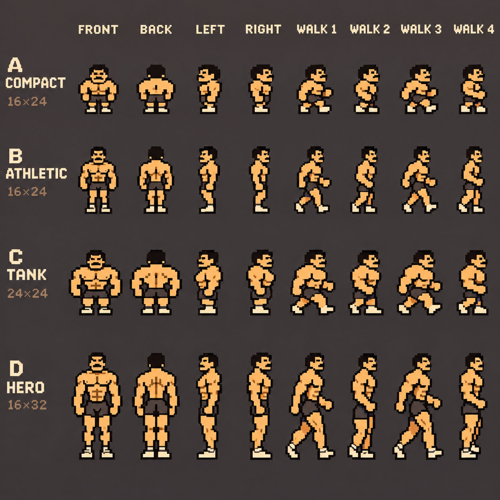
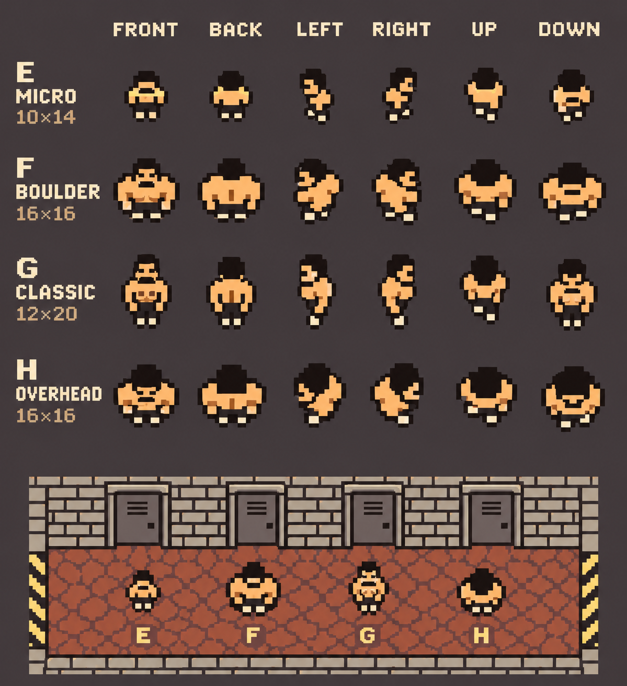
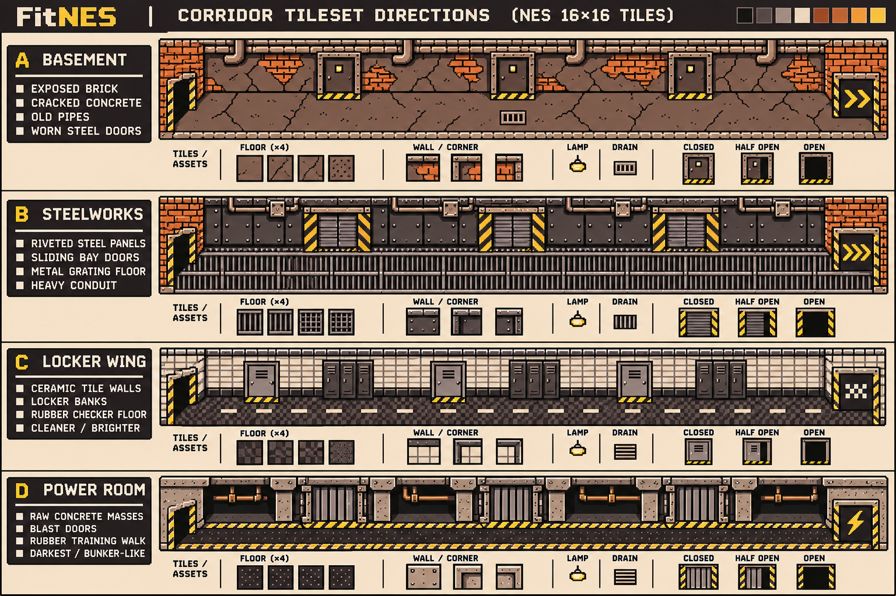

# Corridor interstitial art studies

First-round alternatives, 2026-11-04. These are generated **art-direction
studies**, pending owner selection. No direction is adopted by this addition.

## Character choices

All treatments preserve the home lifter's bare chest, dark short shorts, dark
hair, warm skin, muscular shoulders and light shoes. Letters identify choices
independently of the corridor letters.

| Character | Direction |
| --- | --- |
| A — Compact | Squat, big-headed adventure-game silhouette |
| B — Athletic | Smaller head, tapered torso and longer legs |
| C — Tank | Wide heavyweight with compact legs |
| D — Hero | Taller classic action-game proportions |
| E — Micro | Most reduced, tiny overhead actor |
| F — Boulder | Broad, almost square overhead silhouette |
| G — Classic | Compact figure with more torso definition |
| H — Overhead | Strongest foreshortening, emphasis on head and shoulders |

## Corridor choices

| Kit | Materials and shape language |
| --- | --- |
| A — Basement | Broken plaster, exposed brick, cracked concrete and hinged steel doors |
| B — Steelworks | Riveted panels, heavy sliding doors and metal grating |
| C — Locker Wing | Ceramic walls, locker banks and checker rubber flooring |
| D — Power Room | Concrete buttresses, deep service alcoves and ribbed blast doors |

Each kit explores an entrance, repeatable set-door sections and a distinct
terminal exit. The component strips cover floors, walls/corners, lamps,
drains/vents and closed/partly open/open doors. Kits and characters can be mixed.

## Intended sequence

The whole workout occupies one corridor: an entrance, one door per set, then a
terminal exit. After logging a set, the character leaves its room through the
current door, walks along the corridor to the next door, then enters the next
set's room. The last set leads to the terminal exit. This records the owner's
requested composition for the art; timing and workout integration remain open.

## Sources and production status

Created with the image generation tool using the [original home
reference](../../docs/reference-home-screen-image.png), [final home
art](../home/gym.png), and the corridor capture's `contact_1.png` at pinned commit
`20bc3275240d723586f24877838c908bce5ffad3`. The [vision](../../docs/vision.md)
links the movement reference. The overhead sheet additionally references the
first character sheet to explore a smaller interpretation of the same lifter.

The PNGs are comparison boards, **not native sprite atlases or validated NES
assets**. Dimension labels inside the generated boards are design targets, not
measurements of exported cells. Backgrounds, lettering and samples are baked
into the images; walking poses and door states are studies, not playback-ready
animations. The images have not been quantized to the home PPU palettes and
have no hardware construction proof.

After selection, redraw the chosen character on exact native frame cells,
complete consistent walk cycles for all needed directions, separate transparent
sprites and tile modules, align door states, and validate the assembled screen
against the shared home palettes and NES sprite limits. Keep the vision's NES
contract in force during that production pass.
