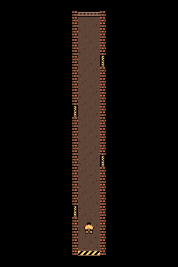

# Vertical basement corridor with character F

The owner selected **F — Boulder** and **A — Basement**, running vertically for
phones. The entrance is at the bottom; four alternating side doors represent
sets; the final exit is at the top. This sample develops that composition without
integrating workout behavior.

Following the owner's DW3 perspective correction, the corridor is a **32-pixel
walking lane with 8-pixel wall caps on either side**, 48 pixels total. Everything
outside this strip is pure black. The brick caps and small door crossbars are
seen from above; there are no tall wall faces or upright door facades.



- [256×240 checked sample](sample.png) and [its hardware construction](sample.json).
- [Background PNG](background.png) and [indexed map](map.json), 256×384.
- [Native tile definitions and placement grid](layout.json), with brick caps,
  four concrete floor patterns, side-door thresholds, an entrance and an end gate.
- [Character source](character.json): exact 16×16 cells, front idle plus rear idle
  and two rear walking poses. Transparent, crisp SVG exports accompany it.
- [Phone review](preview.html): full-height composition and the checked viewport.

## Hardware evidence

The entire map shares the home's four background palettes and whole-frame red
emphasis. Character skin and dark inks use the home's first two sprite palettes.
The checked composition has **nine visible colors, eight 8×8 sprites, at most
four sprites per scanline**, and MMC5 extended 8×8 attributes. There are no
mid-frame palette changes. Tile-count capacity is outside the visual contract.

The 384-pixel overview is a tall map, not one oversized NES frame. The build
checks all **19 overlapping, tile-aligned 256×240 views × four character poses
= 76 compositions**. The checker regression also verifies every view of the
retained background PNG and the delivered sample's exact pixels. This evidence
does not claim arbitrary fine-scroll offsets, full door animation, a complete
four-direction walk cycle, or a running scrolling NES game.

FCEUmm independently reproduces the bottom sample and top/middle views with
**zero differing pixels in each 61,440-pixel frame**, after 180 frames. The
generated ROMs, captures and reports stay under ignored `work/`.

```sh
# Rebuild PNGs, transparent SVG sprites, constructions and all 76 checks
npm run art:corridor

# Verify the exact retained sample independently
npm run nes:proof -- art/corridor/vertical/sample.json art/corridor/vertical/sample.png

# Reproduce its pixels with the pinned emulator (setup once if needed)
npm run nes:emulator:setup
npm run nes:emulate -- art/corridor/vertical/sample.json art/corridor/vertical/sample.png work/nes-emulator-core/fceumm_libretro.so --out work/corridor-emulator/bottom

# Additional views produced by art:corridor
npm run nes:emulate -- work/corridor-proof/scroll-0.json work/corridor-proof/scroll-0.png work/nes-emulator-core/fceumm_libretro.so --out work/corridor-emulator/top
npm run nes:emulate -- work/corridor-proof/scroll-72.json work/corridor-proof/scroll-72.png work/nes-emulator-core/fceumm_libretro.so --out work/corridor-emulator/middle
```

## Construction and remaining art work

The background is built from explicit reusable 8×8 patterns and a 32×48 tile
placement grid. Its colors follow the selected basement art, while its narrow
floor-plan composition follows the DW3 corridor reference. Each tile selects
one of the home's four background palettes. Character F uses native 16×16
two-palette sprites. The proof inputs are the indexed constructions and exact
PNGs, independent of the generated composition study.

The canonical files are `layout.json` and `character.json`; the TypeScript build
assembles `map.json` and reconstructs all delivered sample pixels. Their four shared palettes
and display interpretation are documented in the [hardware verifier](../../../tools/nes-hardware/README.md).

This is a composition sample with reusable tile patterns and a placement grid.
Opening doors, complete walk cycles, configurable corridor sections and workout
transitions remain to be developed after visual feedback. A regression check
requires every pixel outside the 48-pixel corridor strip to remain pure black.
