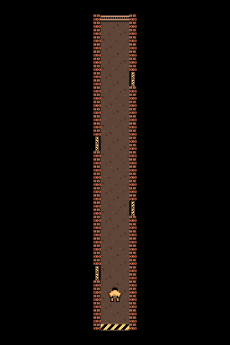
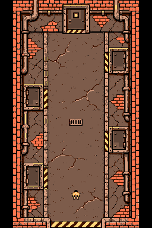
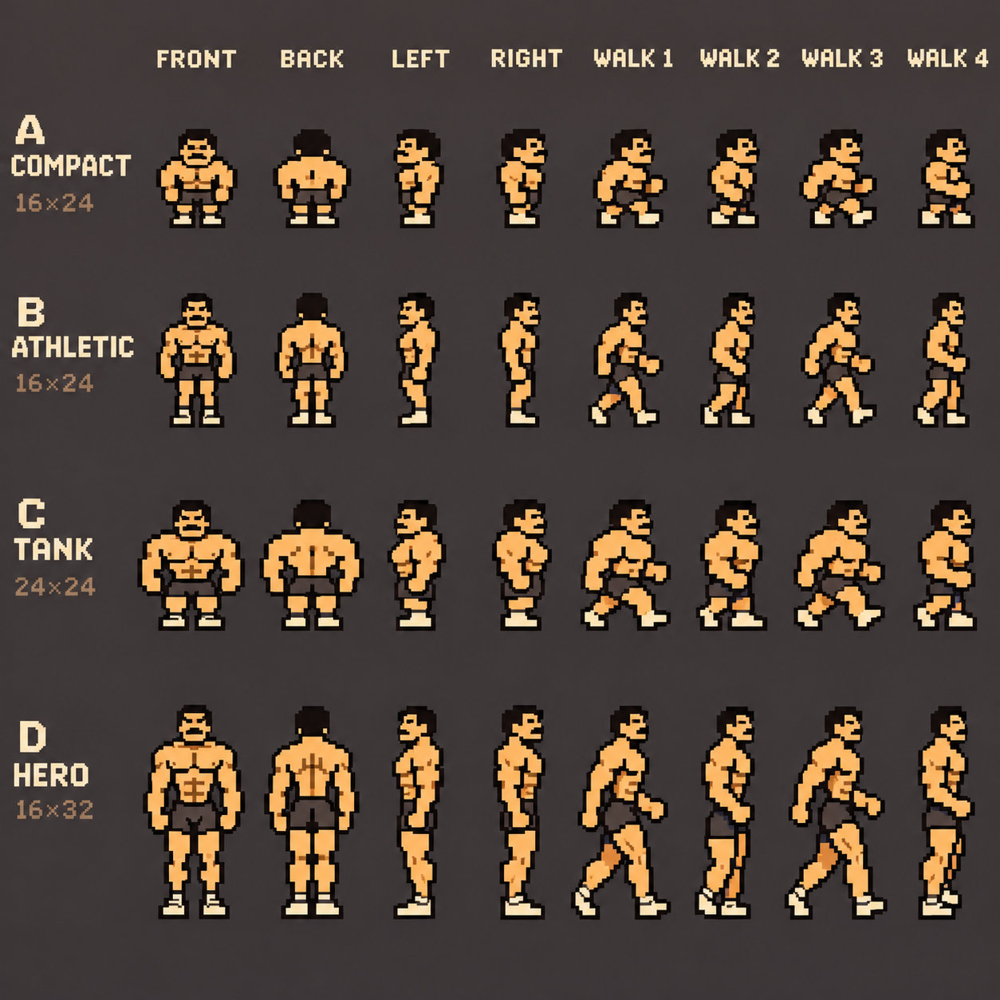
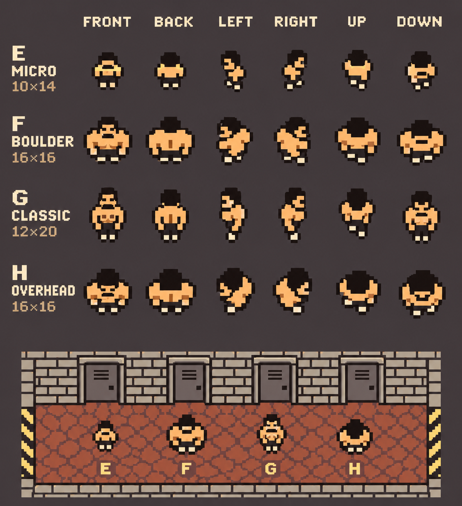

# Workout corridor interstitial art reference

Design decisions and assets collected on 2026-11-04 for **future implementation**.
Implementation is deferred behind the earlier work in the [backlog](../../backlog.md).
Use this folder as the starting point when that feature becomes the next task.

## Owner decisions

- **Environment:** corridor A — Basement is the preferred material direction:
  worn concrete, rusty brick, dark steel and warm hazard markings, matching the
  [home artwork](../../../art/home/gym.png).
- **Character:** **F — Boulder is preferred, provisionally**. The owner may change
  their mind. Keep all character sheets A–H available when implementation starts.
- **Identity:** the same muscular lifter as the home screen, shirtless, in dark
  shorts, with dark hair, warm skin and light shoes. Keep him recognizable at
  very low resolution.
- **Orientation:** vertical, to suit phone screens.
- **Camera and framing:** follow the DW3 reference closely: a **thin corridor,
  viewed from above, with the rest of the screen black**. Use narrow wall caps
  and small door thresholds seen from above. The wide study's tall wall faces
  and upright door facades were rejected. Retain its assets for material and
  tile reference, rather than treating that perspective as an approved option.
- **Progress:** the whole workout is one corridor, with a beginning, successive
  doors for sets, and an end for the last set. The sample puts the entrance below
  and the final gate above.
- **Sequence:** after logging a set, show the character coming through the
  current room's door, walking along the corridor to the next door, and entering
  the next set's room. The final set ends at the corridor's terminal exit.
- **Hardware:** preserve the existing NES visual contract. These decisions do
  not introduce a visual exception. Tile-count capacity remains outside that
  contract; colors, resolution, palettes and sprite budgets remain constrained.
- **Priority:** this is retained design preparation. There is substantial work
  to implement before the interstitial. Timing and interaction remain open.

The current sample uses a 32-pixel walking lane with 8-pixel walls on each side,
48 pixels total. Those measurements describe the retained sample; the approved
direction is the thin, top-view composition on black.

## Both corridor versions

| Version | Status | Assets |
| --- | --- | --- |
| [Thin top view](corridors/thin-top-view/) | Preferred composition; DW3 framing on black | Named tile definitions, placement grid, native tile atlas, indexed map, background, overview and checked sample |
| [Wide basement](corridors/wide-basement/) | Earlier material study; perspective rejected | Native tile atlas, placement data, indexed map, background, overview and checked sample |

Both native maps are 256×384. Their `sample.png` files are 256×240 hardware-sized
views. `overview.png` includes character F near the entrance; `background.png`
contains only the environment.

### Preferred thin top view



[Native tiles](corridors/thin-top-view/tiles.png) ·
[Tile definitions and placement data](corridors/thin-top-view/tiles.json) ·
[Named source tiles and layout](corridors/thin-top-view/layout.json)

### Earlier wide basement study



[Native tiles](corridors/wide-basement/tiles.png) ·
[Tile definitions and placement data](corridors/wide-basement/tiles.json)

### Using the tiles

Each version's `tiles.png` is an **8×8 native tile atlas**, with no gutters. Its
matching `tiles.json` records:

- `columns`: the number of tiles across the PNG; tiles are ordered left to right,
  then top to bottom.
- `tiles`: one palette index and 64 base64-encoded two-bit palette slots per tile.
- `placements`: row-major tile IDs for the 32×48 map grid.
- `width`, `height`, `tileSize`: the native map dimensions and cell size.

The four background palettes and emphasis state live in that version's
`map.json`. A tile is deduplicated by **both** its pattern and palette. Tests
reconstruct each entire map from its tile definitions and placements and compare
the atlas PNG against the declared colors exactly. Empty atlas padding is black.

The thin version also has readable source tile names in `layout.json`: `w` is a
brick wall cap; `a`–`d` are floor variants; `l`/`r` are side thresholds; `e` is the
end gate; `s` is the entrance; `.` is black. The wider version's atlas is a
lossless extraction from its indexed study, without semantic wall/floor labels.

## Sprites and all character alternatives

The [F source](sprites/character-f.json) contains exact 16×16 cells: front idle,
rear idle, and two rear walking poses. Its inks declare hardware palette/slot
pairs, and `.` means transparent. These are starting poses, not a complete
animation set. The SVG exports preserve transparent backgrounds and native
pixel cells:

| Front idle | Rear idle | Rear left step | Rear right step |
| --- | --- | --- | --- |
|  |  |  |  |

All eight character alternatives remain available as concept sheets:

| Letter | Direction |
| --- | --- |
| A — Compact | Squat, big-headed adventure-game silhouette |
| B — Athletic | Smaller head, tapered torso and longer legs |
| C — Tank | Wide heavyweight with compact legs |
| D — Hero | Taller action-game proportions |
| E — Micro | Smallest, most reduced overhead actor |
| F — Boulder | Broad, almost square overhead silhouette; current preference |
| G — Classic | Compact figure with more torso definition |
| H — Overhead | Strong foreshortening, emphasis on head and shoulders |





The [environment comparison sheet](sheets/corridor-kits-a-d.png) also retains the
original horizontal corridors and component studies for A — Basement,
B — Steelworks, C — Locker Wing and D — Power Room.

The generated sheets are concepts, with labels, backgrounds and poses baked
into them. Their printed sizes are targets, not measured native export cells.
Only F has been redrawn into the native sprite source here. The other sheets
remain available for reconsidering the character; they are not validated sprite
atlases or complete animations.

## Verification and reproduction

Both native versions share the home's four background palettes, first two
sprite palettes and whole-frame red emphasis. Each checked sample has **nine
visible colors, eight 8×8 sprites, and at most four sprites per scanline**, using
MMC5 extended 8×8 attributes. No mid-frame palette writes are required.

The rebuild checks **19 overlapping tile-aligned views × four poses = 76
compositions per version, 152 total**. A 384-pixel overview is a tall map, not a
single oversized NES frame. These checks do not prove arbitrary fine-scroll
offsets, opening-door animation, or a running scrolling NES game. The native
sprite exports and atlas definitions preserve the exact PPU colors; generated
concept sheets do not carry a hardware claim.

Both versions' retained sample frames reproduce in FCEUmm with **zero differing
pixels across all 61,440 pixels**, after 180 frames.

```sh
# Rebuild both versions, tile atlases and sprite exports; run all 152 checks
npm run art:corridor

# Independent proof of the preferred sample
npm run nes:proof -- docs/design/corridor-interstitial/corridors/thin-top-view/sample.json docs/design/corridor-interstitial/corridors/thin-top-view/sample.png

# Independent proof of the wider study
npm run nes:proof -- docs/design/corridor-interstitial/corridors/wide-basement/sample.json docs/design/corridor-interstitial/corridors/wide-basement/sample.png

# Emulator setup, once if needed
npm run nes:emulator:setup
npm run nes:emulate -- docs/design/corridor-interstitial/corridors/thin-top-view/sample.json docs/design/corridor-interstitial/corridors/thin-top-view/sample.png work/nes-emulator-core/fceumm_libretro.so --out work/corridor-emulator/thin-top-view
```

The build places additional view constructions and PNGs under
`work/corridor-proof/<version>/scroll-<offset>.{json,png}`, at offsets 0–144 in
steps of eight. Feed these to `nes:emulate` for additional independent checks.
Generated ROMs, emulator captures and reports stay in ignored `work/`.
See the [hardware verifier](../../../tools/nes-hardware/README.md) for the display
interpretation and proof limits.

The canonical thin source is `layout.json`; the canonical wide source is
`map.json`. Both use the shared `sprites/character-f.json`. The TypeScript build
retains the full native map construction, tiles and checked images. The wider
study preserves its earlier pixels; moving it into this package does not adopt
its rejected perspective.

## Starting implementation later

Revisit these decisions after the preceding backlog work, then choose the final
character with the owner. Start with the preferred thin layout and the retained
reference capture. Still to design and implement:

- Complete walk cycles and all directions needed to enter and leave side doors.
- Door opening/closing states, occlusion and transitions into/out of set rooms.
- Corridor generation from actual workout sets, entry, progress and final exit.
- Timing, reduced-motion behavior and interruption/resume behavior.
- Scrolling, phone composition and hardware proof of the assembled animated UI.
- Integration with workout logging and its persistence model.

## References and review

- [Local DW3 contact sheet](references/dw3-contact.png), retained from the
  corridor capture at commit `20bc3275240d723586f24877838c908bce5ffad3`.
- [Original corridor capture](https://feat-corridor-transition.fitnes-corridor-capture-preview.pages.dev/).
- [Original home reference](../../reference-home-screen-image.png) and
  [final native home art](../../../art/home/gym.png).
- [Product vision](../../vision.md), [backlog](../../backlog.md), and
  [static review page](preview.html).

Open `preview.html` directly in a browser or use `npm run dev` and visit
`/docs/design/corridor-interstitial/preview.html`. This page is an asset review;
the interstitial is not wired into the workout app.
