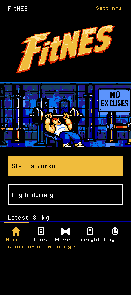
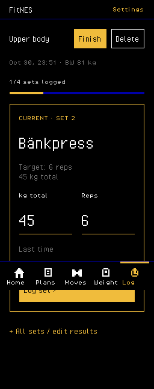
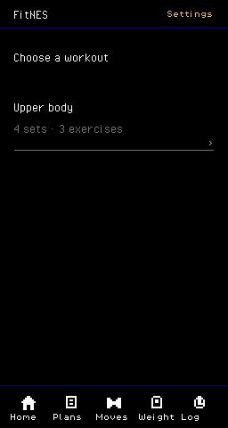
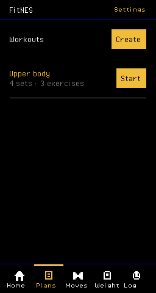
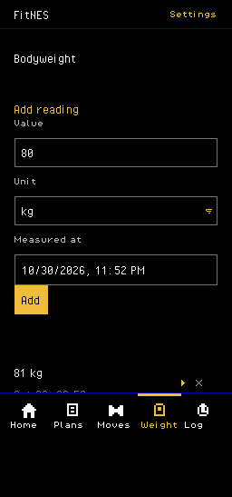
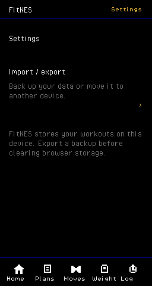

# Focused NES UI

The home screen carries the FitNES logo and gym character. Its primary actions
are Start a workout (choose an existing plan) and Log bodyweight. In-progress
sessions can be continued. The workout screen has no character: it puts the
current prescription, editable actuals, previous result, and Log set first.

Plans, exercise definitions, bodyweight history, and session history remain
reachable from the fixed bottom tabs. Import/export is under Settings. Existing
valid edits persist immediately; creating a plan/exercise, logging a set, and
replacing the database remain explicit actions.

These screenshots contain synthetic test data, never the owner's workout data.
The short bench-press example is named Bänkpress to exercise Swedish glyphs.

| Home | Current set |
| --- | --- |
|  |  |

| Choose a workout | Saved workouts |
| --- | --- |
|  |  |

| Bodyweight | Settings |
| --- | --- |
|  |  |

The directory also includes create/edit screens for workouts and exercises,
expanded planned-set controls, start-session options, session history and
completed-session review, timed/per-side sets, all-sets review, and import/export
success/error states. `workout-phone.png` is a real 390×844 CSS-pixel Chromium
capture at DPR 3. The content column is enlarged exactly 4× in device pixels;
the surrounding margin stays black.

## Reproduce

```sh
npm ci
npm run check
npm run build
npm run ui:check
```

Use `CHROME_PATH=/path/to/chrome` if Chromium is not at `/usr/bin/chromium`.
The UI check starts its own Vite instance on port 5179, opens a clean browser
context, seeds synthetic data only there, exercises persistence and interactions,
and checks its actual screenshots with the checker adopted from PR #11.
It leaves PNGs and `nes-reports.json` in ignored `work/ui/`.

All 26 captures in [the reports](nes-reports.json) passed. The phone report
checks the known content rectangle at device x=73, width=1024 and scale=4,
including every pixel in each 4×4 block. Native screenshots use normal Chromium
rendering at 256 logical pixels wide. No screenshot quantization, smoothing
suppression, extra palette allowance, or other visual exception is used.
The checker has unlimited tile patterns, as specified by the current contract.

The browser check covers logging an edited weight, reloading, timed and separate
left/right actuals, completion/reopening/clearing, adding bodyweight, exporting,
rejecting an invalid import, and restoring a valid export. CI runs the same
checks and uploads its screenshots as an artifact.

## Data and preview origins

The preview is on a separate origin. The existing compact preview and its
IndexedDB data are unchanged. To try existing data here, export JSON from the
compact preview, then use Settings → Import / export on this preview. An import
validates the whole document before replacing data on its own origin.
