# FitNES typography and menu research

Research only. Nothing in this document has been implemented. Branch inspected: `cursor/nes-window-ui-81c6` at `0f811eb` (`feat(ui): put the quantized poster on the home page`). Screenshots were taken from the running app with a seeded workout, at 256 CSS pixels and device scale 1, using the same Chrome flags as `nes/pagePicture.test.ts`. Enlargements are nearest-neighbor, so they add no new colors.

A future implementation agent should be able to prototype from this file without repeating the research.

## 1. Executive summary

The font is hard to read because it is one 8×8 uppercase bitmap used for every role. Lowercase code points are the uppercase tiles (`src/app/hudFont.ts`), and `body` also sets `text-transform: uppercase` (`src/styles/global.css`). Titles, names, sentences, column headers, and numbers are the same size, the same weight, and almost the same color. `--text-muted` is white. A Swedish name such as `Bänkpress` loses `ä` and draws the missing-glyph box.

Prototype **Pixel Operator** first (Jayvee Enaguas, CC0). Use the 16px cut for exercise names, descriptions, and the weight/reps digits, and **Pixel Operator 8** for section kickers, column headers, and badges. Both cuts rendered as only black, white, and gold at their native sizes under the project's Chrome flags. Digits are tabular. `å`, `ä`, and `ö` are present. `→` is not. If the set table needs a strict 8px column, or the JSON screen tool must use the same glyphs, fall back to **GNU Unifont** at 16px (8×16, SIL OFL). Do not start with Press Start 2P, Silkscreen, or VT323.

Capitalization: sentence case for screen titles, exercise names, descriptions, and buttons. Uppercase only on the 8px cut, and only for kickers, column headers, and badges of one to three words. Numbers stay tabular and do not get a case style.

Menus get richer by losing chrome, not by adding it. The project's own workout dashboard already does this: gray labels, white values, one panel for the timer, and a full-width gold band for the current set (`nes/examples/workout-dashboard.json`). The live CSS app put that window frame on every card, so the frame no longer means anything, and the blue fill uses up the four colors a 16×16 region is allowed. Drop the per-row frame. Put gray text on the black ground. Mark the current set by inverting the whole row to black on gold, so it survives a grayscale screenshot.

The all-caps look is a design convention of the current font, not a rule the page checker enforces. The checker enforces palette, tile colors, attribute regions, and a 256-pixel column. The JSON text tool additionally requires glyph width and height to be multiples of 8. The page checker does not.

## 2. Current FitNES visual diagnosis

### How text is actually drawn

The live UI is CSS, not the NES framebuffer. On boot, `src/index.tsx` measures the viewport, builds a TrueType font, and installs it as the family `FitNES HUD`.

`src/app/hudFont.ts` reads the 8×8 bitmaps in `nes/assets/fitnes.json` (`fonts.hud`), plus a handful of extra marks (`×`, `·`, `→`, an `M` that is not identical to `N`). Each lit pixel becomes a square in a TrueType glyph. The em is 64 units, 8 units per NES pixel, and every glyph advances one em. `font-size: calc(var(--px) * 8)` is therefore one logical pixel per bitmap pixel when `--px` is 1.

Lowercase is not a second design. After the uppercase glyphs are built, `src/app/hudFont.ts` maps `a`–`z` onto `A`–`Z` (the loop around the comment `Lowercase points at the same tile as uppercase`).

`hudFont.test.ts` locks that alias in. Turning off CSS `text-transform` does nothing to the letters. The specimen below is the installed font, rendered in Chrome.

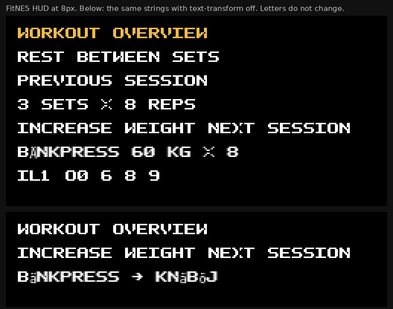

Measured on that render, at 1 CSS pixel per logical pixel:

| Sample | Ink height | Width |
| --- | --- | --- |
| `WORKOUT OVERVIEW` | 7px | 127px |
| `INCREASE WEIGHT NEXT SESSION` | 7px | 223px |
| `BÄNKPRESS` | 7px, with a box where `ä` should be | — |
| `Il1 O0 6 8 9` | 7px | `I`, `l`, and `1` share one advance |

The blank eighth row is the only leading. `body` sets `line-height: 1`, so a second line starts 8px later. There is no room in the cell for a descender that is not also the capital.

The tile source in `nes/assets/fitnes.json` is uppercase, digits, space, and `. , : ! ? ' - / + ( ) #`. The CSS face adds the extra marks, including a rewritten `M`, because the tile `M` shares `N`'s diagonal (`hudFont.ts` says a menu label would read as `N`). The JSON font used by `npm run nes:render` still has the ambiguous `M`.

`toLocaleString()` dates and user-typed exercise names are not limited to that set. The home screen below was given a template named `Bänkpress`. The `ä` is gone.

### What the screens do with that font

Every role shares the 8px face. `h1`, `h2`, labels, buttons, and paragraphs set `font-size: inherit` and `font-weight: inherit`. The only size change in the product is the logo and the hero, which are pictures.

Color does not carry the hierarchy either. `--text-primary`, `--text-secondary`, `--text-muted`, and `--text-heading` are all `--nes-white`. `--nes-gray`, `--nes-silver`, and `--nes-green` are defined and unused. Gold is the title color, the primary button's text, the selected tab bar, and the set index. Red is errors. Everything else is white on blue or white on black.

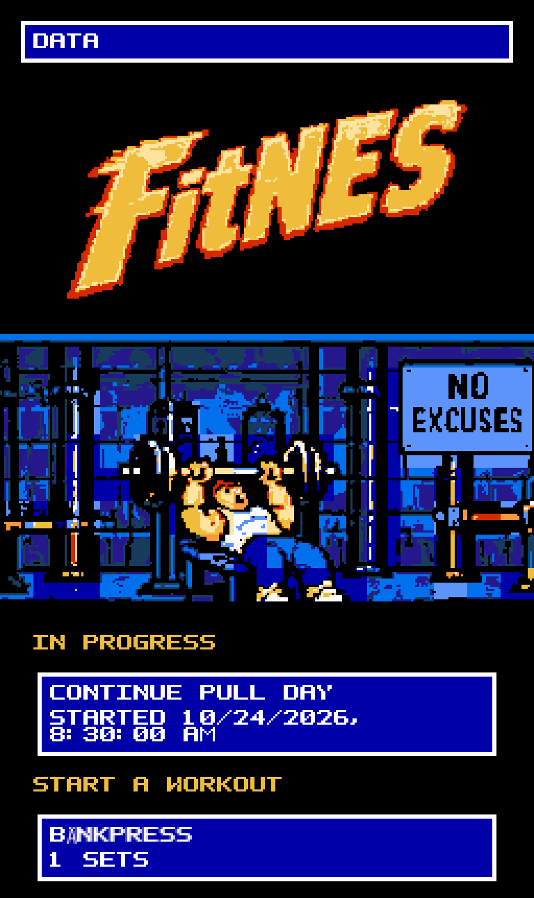

The poster and the wordmark are doing the industrial-gym job. The menu underneath is a stack of identical windows. `IN PROGRESS` is gold, and it is the same size and the same capitals as `CONTINUE PULL DAY`. The date wraps because `10/24/2026, 8:30:00 AM` is a long all-caps string at 8px. `1 SETS` is a copy bug (`template.sequence.length` plus a hard-coded plural); it is minor next to the type, and it is called out so a styling pass does not treat it as a font problem.

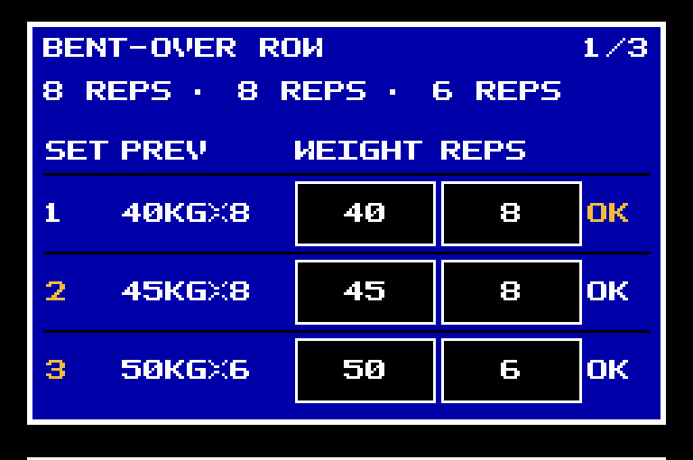

This is the screen that has to be scannable with a thumb over a bar. Observed on the seeded session:

- The target line repeats the count and hides the load: `8 REPS · 8 REPS · 6 REPS`. Weight, which is what changes, is only inside the inputs.
- `SET` and `PREV` sit on each other. The set column is 28 logical pixels (`src/App.css`, `.set-table__set`), which is three and a half capitals.
- Previous-session text is the same white as the current digits. The class is `set-cell--muted`, and muted is white.
- The logged row and the other rows share the same frame. The only difference is that `OK` turns gold. That signal disappears if the gold is hard to see, and it does not change the word.
- The column header is hard-coded `Reps` in `src/components/session/ExerciseBlock.tsx`, including for a duration exercise.
- Bodyweight renders as `BW`, which is good and short. Per-side curls render two inputs and a slash, which is the right information and a very tight row.

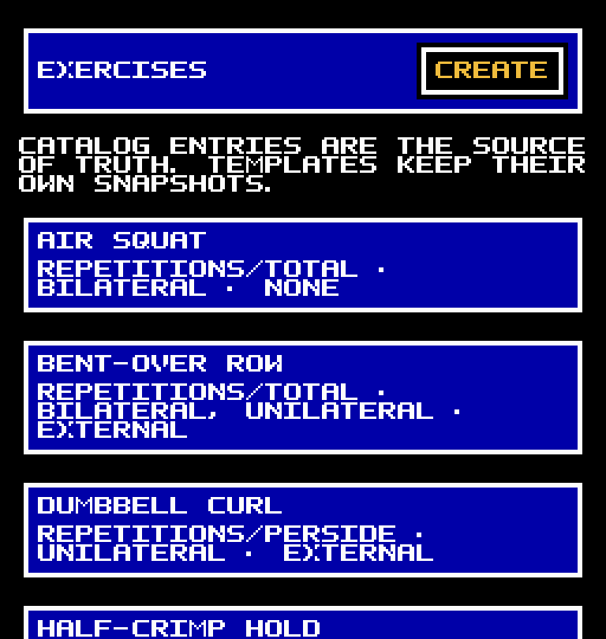

`Catalog entries are the source of truth…` is a sentence set in the same capitals as `AIR SQUAT`. Every row then repeats a machine string: `REPETITIONS/TOTAL · BILATERAL · NONE`. That string is the exercise's capability model (`src/pages/ExerciseListPage.tsx`). It is useful on the edit screen. On the list it makes every row the same height and the same weight.

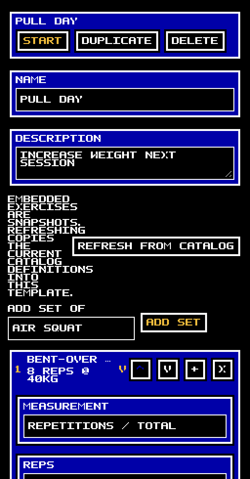

`src/App.css` `.row-split` is `flex-wrap: nowrap`. The snapshot sentence and `REFRESH FROM CATALOG` share one row. At 256 logical pixels the sentence collapses to a few capitals per line. The planned-set row then ellipsizes the exercise name (`planned-set__name` is `white-space: nowrap`) because the caret and four icon buttons take the rest of the row. The prescription (`8 REPS @ 40KG`) is the part worth seeing, and the name is the part that gets cut.

The five bottom tabs are 32×32 pictures with a gold bar on the selected one and no word. `aria-label` carries the name for assistive tech. Visually, the bar is the only label.

### The art and the menus do not share a system

The hero, the logo, and the tab icons are PNGs with `image-rendering: pixelated`. They were quantized onto the master palette, and the home route passes `assessPicture`. The logo is a mixed-case script. `public/nes-style-reference.png` is also mixed case (`Today's Workout`, `Bench Press`, `Keep going!`). That reference is a mood board: it uses more colors than a background subpalette allows, and it is not a specification. The letterforms in it are still the direction the UI font refused.

The CSS windows use one recipe for cards, headers, fields, planned sets, and buttons: a blue fill, a 2px black inset, and a white frame (`src/styles/global.css`, the `.pane, .card, …` rule). The comment there is right that a diagonal cut would blend two colors. The result is that a button and a paragraph and a list row are the same object.

The JSON dashboard, which the last styling pass did not adopt as the page layout, already separates those jobs:

- Palette 0 ground: gray ink for `SET`, `KG`, `REPS`, `SET 3 OF 5`; white ink for the numbers.
- One blue panel, around the timer only.
- A full-width gold band behind the current set, two tiles tall.
- Open rows, a single rule under the header, no box per set.

See `nes/examples/workout-dashboard.json` and `nes/examples/workout-dashboard@3.png`.

### Fractional scale softens the type and not the pictures

`src/app/nesScale.ts` sets `--px` to `viewport / 256`, so a 390 CSS-pixel phone gets `--px ≈ 1.523`. Pictures use `image-rendering: pixelated` and stay on the grid. The font is a vector of squares. At `font-size: 12.1875px` the square edges fall between device pixels.

At 256 CSS pixels the session text is exact `#fcfcfc` and `#f0bc3c`. The other master-palette colors in that screenshot are in the tab icons, not in the letters. At 390 CSS pixels the same screen produced hundreds of off-palette edge colors. A white run sampled in the header had `#f0` and `#18` neighbors beside `#fc`. The picture test never sees this, because it forces the viewport to 256 and device scale 1.

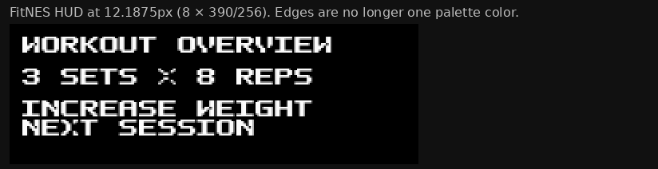

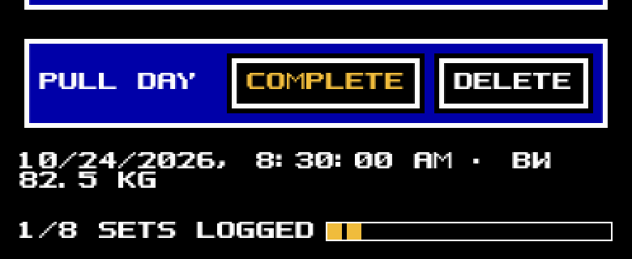

Commit `5ec713b` chose to fill the width. That choice is why the font cannot stay crisp on a phone. It is a real trade-off, and it is recorded under Priority 2. Do not undo it casually.

## 3. Typography research and candidate-font comparison

### Uppercase, mixed case, and this font in particular

Two findings get quoted as if they disagreed. They measure different things.

Arditi and Cho, "Letter case and text legibility in normal and low vision," *Vision Research* 47 (2007), [PMC2016788](https://pmc.ncbi.nlm.nih.gov/articles/PMC2016788/). At the acuity limit, uppercase is identified at a smaller size than lowercase, because the letters are physically larger. For normally sighted readers that advantage went away once the type was comfortably large. The paper is about letter size, not about a page of labels that are all the same size.

Nielsen Norman Group, ["Typography for Glanceable Reading"](https://www.nngroup.com/articles/glanceable-fonts/), summarizing Sawyer and others: for a word or two, seen once, a larger letter wins. Uppercase beat lowercase in that glance task because it was bigger. The same article says the result does not license all-caps for sentences. Their older rule of thumb, that all-caps costs about 10% on longer text, is the continuous-reading claim, and it is the one that matches a workout note (`Increase weight next session`) and the catalog sentence.

Applied to FitNES:

- The current capitals are 7px tall. Replacing them with lowercase inside the same 8px cell makes the lowercase smaller than today's capitals. That is the Arditi penalty, and it is what Press Start 2P does. It is not a readability upgrade.
- A mixed-case face whose x-height stays near 7px, with ascenders and descenders outside that, keeps the glance size and adds a word shape. That face is taller than 8px. Unifont at 16px and Pixel Operator at its 16px em are in this class.
- Pixel Operator 8 is the in-between case. At a native 8px it still has a 7px ink height on `Rest between sets`, and descenders push `Increase weight` to 8px. The word is 178px wide instead of 223px. Word shape appears without shrinking the ink below today's capitals. `I` and `l` remain close; `1` is wider and has a base; `0` is dotted. Good enough for labels, tighter than Unifont, and the first thing to try on the set table if 16px rows feel too tall.
- Uppercase remains the right treatment for a kicker of one to three words (`SET`, `PREV`, `BW`), where there is no sentence to recognize and the smaller 8px cut should look like a label rather than a second copy of the name.

Do not letter-space the capitals to "open them up." The current face is already one tile per letter. Extra tracking would drop the set table below the number of digits it can show. The NN/g glance research also found condensed text slower than regular width.

### What was rendered

Each candidate was loaded in Chrome with `--font-render-hinting=none`, `--disable-font-subpixel-positioning`, `--disable-lcd-text`, and device scale 1. The stage was then counted for colors. "Crisp" means the specimen stage contained only `#000`, `#fcfcfc`, and `#f0bc3c`.

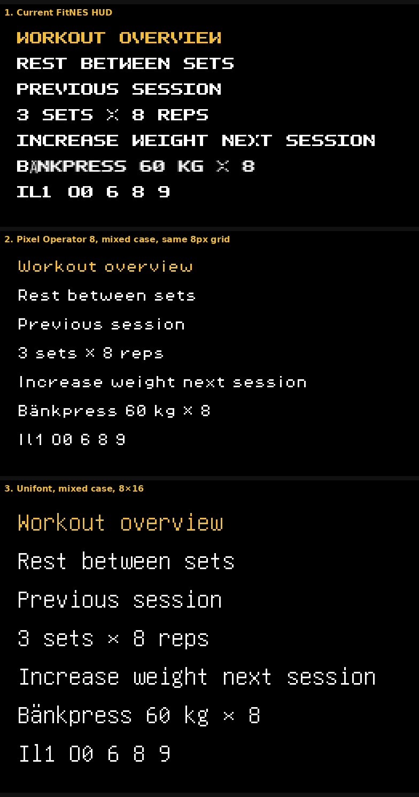

| Face | Native size used | Crisp? | Ink | Width of the long sentence | `åäö` | Digits |
| --- | --- | --- | --- | --- | --- | --- |
| FitNES HUD | 8px | yes, at `--px: 1` | 7px | 223px | no | tabular, `I`/`l`/`1` share an advance |
| Pixel Operator 8 | 8px | yes | 7px, 8px with descenders | 178px | yes | tabular; `1` wider than `I` and `l` |
| Pixel Operator | 16px | yes | about 9–11px | 178px | yes | tabular, same 7px advance as the 8px cut |
| GNU Unifont | 16px | yes | 10–13px | about 221px | yes | tabular 8px, slashed zero, serif `I` |
| m5x7 webfont | 16px | yes | x-height about 5px, 9px with ascender and descender | about 151px | **no in the file inspected** | `1` wider than `I` |
| Press Start 2P | 8px | yes | 7px | 222px | yes | tabular, lowercase trapped in the capital cell |
| Silkscreen (Google Fonts) | 8px | a few gray pixels | 5px | about 149px | yes | proportional, smaller than the HUD |
| CozetteVector | 13px | yes, in this Chrome | about 8px | about 166px | yes | author warns the vector build is not reliable |
| VT323 | 20px | no, 247 colors | — | — | yes | antialiased, fails the picture check |

Individual renders:

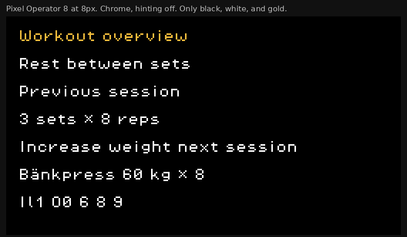

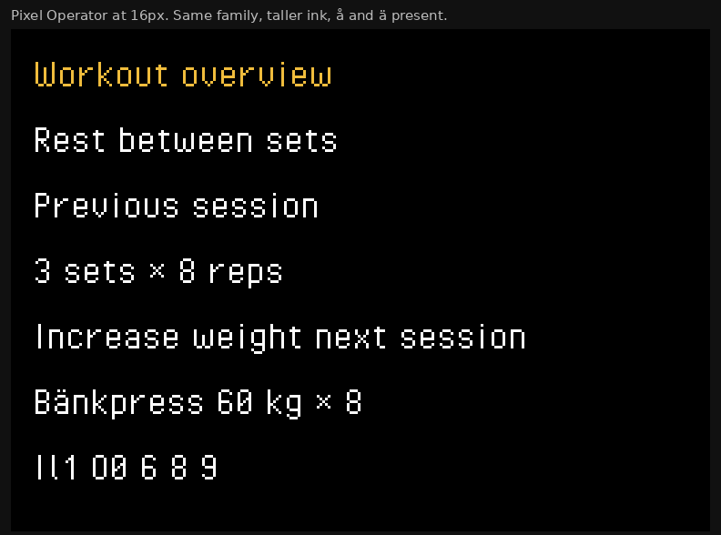

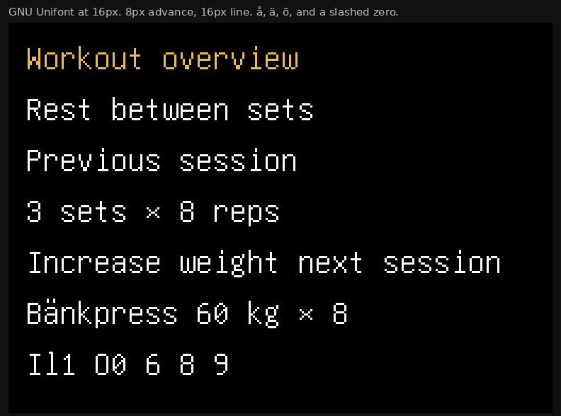

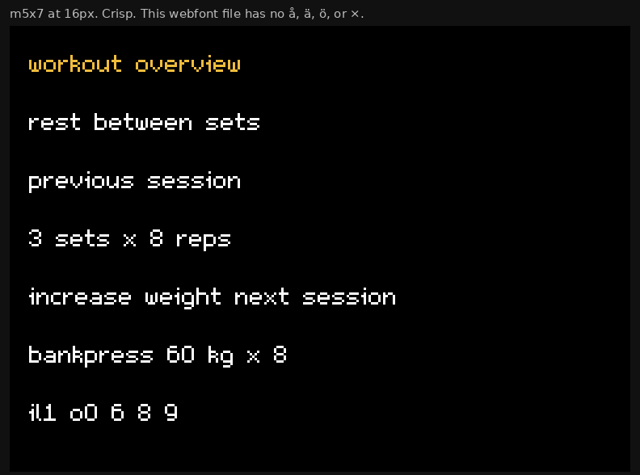

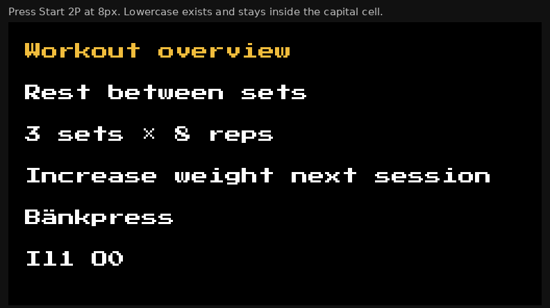

### Candidates worth using

**Pixel Operator and Pixel Operator 8. Prototype these first.**

- Source of the files inspected: the CC0 copies in [ericoporto/pixel-utf8-fonts](https://github.com/ericoporto/pixel-utf8-fonts) (`pixeloperator/PixelOperator.ttf`, `pixeloperator8/PixelOperator8.ttf`). The designer's repo is [notabug.org/HarvettFox96/ttf-pixeloperator](https://notabug.org/HarvettFox96/ttf-pixeloperator). DaFont also hosts the family, including Mono and Bold; those two cuts were not rendered here.
- License, from the name table of both files inspected: Creative Commons Zero 1.0, Jayvee Enaguas (HarvettFox96), 2009–2018. Embedding, modification, and shipping inside the PWA are permitted. No attribution is required. Attribution in a font credit is still good practice.
- Mixed case, Latin-1 including `åäöéü`, digits, `×`, `·`, dashes. The files do not contain `→`. The session date uses `→` (`SessionPage.tsx`). Add that one glyph beside the face, the way `EXTRA_GLYPHS` already adds marks, or write the range with a hyphen.
- The 16px cut is the body and the digit face. At `font-size: 16px` the advance of `A`, `0`, `1`, and `8` is 7px (`700 / 1600 * 16`). The 8px cut is the same horizontal grid (`700 / 800 * 8` is also 7px) with shorter glyphs. One family, two sizes, tabular numbers in both.
- Headings: the 16px cut, sentence case, gold. Body: the 16px cut, sentence case. Compact labels: the 8px cut, uppercase. Numbers: either cut, right-aligned. Do not mix in a third family.
- Renderer: both cuts were crisp at native size. They are proportional, so they are legal in the CSS app and illegal as a `text` op glyph unless each glyph is padded to a multiple of 8. See section 5.
- Risk: `I` and `l` are similar at 8px. The logging cells show digits, not those letters. Review `1 I l 0 O` on a phone before adopting the 8px cut for anything the user must distinguish under fatigue.

**GNU Unifont. The contrasting, reading-first option.**

- Source: [unifoundry.com/unifont](https://unifoundry.com/unifont/). The file rendered was `unifont-14.0.04.ttf` from the same pixel-utf8 mirror. Prefer a current release from Unifoundry when implementing.
- License: dual, GPL-2.0-or-later with the GNU font embedding exception, and SIL OFL 1.1 since version 13.0.04. Take the OFL. Unifont's own site says the OFL allows embedding in non-free software. Keep the copyright notice with the file. No reserved font name.
- Coverage is the point. Latin, `åäö`, arrows, and the punctuation the UI already emits are in the cmap that was inspected (57,087 glyphs in that file). A user can name a lift in Swedish and the glyph exists.
- At `font-size: 16px` the advance is 8px and the em is 16px. That is an 8×16 cell: one tile wide and two tiles tall. It can be sliced into the JSON font format without padding. Capitals and lowercase are obviously different. `0` is slashed, `I` has serifs, `1` has a flag and a base.
- It is plain. It looks like equipment stenciled with a technical face, which fits a basement gym, and it does not look like a game logo. That plainness is why it is the contrast case and not the first pick. Pixel Operator has more of the arcade character the hero already has.
- The vertical cost is real: a line is 16 logical pixels instead of 8. On the logging screen the inputs are already 24px tall, so the extra cost is the name and the target line, not every set row. See the hierarchy in section 6.

**m5x7. A density experiment, after the full file is checked.**

- Source and license: [managore.itch.io/m5x7](https://managore.itch.io/m5x7), Daniel Linssen. The itch listing's asset license is CC0 1.0. The page also says attribution is appreciated. The downloadable `m5x7.ttf` could not be fetched in this environment.
- The file that was inspected is the page's webfont (`m5x7-webfont.ttf`, 116 glyphs). It is ASCII plus a few spaces and dashes. It has no `å`, `ä`, `ö`, or `×`. Do not ship that subset. The listing claims the pack itself has accented letters. The implementation agent must open the pack, dump the cmap, and confirm `åäö` and `×` before using it.
- The author's metrics: average width 5, ascender 7, descender 2, x-height 5, use at 16/32/48. The render matched that: x-height about 5 CSS pixels, which is smaller than the current 7px capitals. It fits more sentence on a line (151px versus 223px) and asks the eye to read smaller letters. That is the opposite of the Arditi result. Use it only if a prototype shows the session screen is too tall with Pixel Operator and the full cmap checks out.
- m6x11, same author, is the taller sibling (x-height 8, attribution required, not CC0 on the listing). It was not rendered. It is a reasonable second experiment if m5x7's x-height is too small and Pixel Operator's 16px line is too tall. Confirm the license file inside the download.

### Candidates to reject

**Press Start 2P** ([Google Fonts](https://fonts.google.com/specimen/Press+Start+2P), SIL OFL 1.1, reserved name "Press Start 2P"). Crisp, and it has lowercase and `åäö`. The lowercase is drawn inside the same 8px cell as the capitals, so a sentence is a shorter version of the current problem. Width of the sample sentence matched the HUD within a pixel. There is no hierarchy available inside the family.

**Silkscreen** ([Google Fonts](https://fonts.google.com/specimen/Silkscreen), [kottke.org](https://kottke.org/plus/type/silkscreen/), SIL OFL 1.1). Jason Kottke's 2001 cut has no lowercase; he wrote that descenders would break the horizontal line, and that it should be used at 8pt multiples with antialiasing off. The Google Fonts build now has a lowercase cmap (verified: `a` is not `A`) and `åäö`. At 8px the ink is 5px, shorter than the HUD's 7px. A few edge pixels were not pure white. It is a smaller face, not a more readable one. The bold cut was not rendered; Kottke himself called some bold glyphs illegible.

**VT323** (SIL OFL). Readable at a terminal size and wrong for this renderer. At the 20px size where its 400-unit advance lands on an 8px grid, the stage contained 247 colors. `assessPicture` would fail it.

**Cozette** ([github.com/slavfox/Cozette](https://github.com/slavfox/Cozette), MIT). Excellent coverage, 6×13 bitmap, crisp at 13px in this particular Chrome. The author says the vector TTF is a compatibility build and "doesn't look right at any size," and that bitmap `.otb` is the real face. Browsers will not use the bitmap. A 13px line is also not a multiple of 8, so the JSON text op cannot place it. Not the first prototype.

**Anything traced from a commercial NES game.** `nes/README.md` already forbids it. Final Fantasy, Dragon Warrior, and Fire Emblem are references for layout, not letterforms to copy.

**The logo face.** `src/assets/logo.png` is a picture. It is not a UI font and it should not become one.

### One family

Use Pixel Operator at two sizes. A second family (Unifont for body, Pixel Operator for numbers, a system sans for descriptions) would look like three products on one screen, and the system sans will antialias. Bold cuts exist and were not rendered. Do not depend on bold in the first prototype. Weight, in this palette, is "more white pixels," which is free inside a region that already uses white. Size and case do the hierarchy more honestly.

### Techniques versus the renderer

| Technique | Works today | Needs a code change |
| --- | --- | --- |
| Sentence case | The font ignores it | Stop aliasing `a`–`z`, and remove `text-transform: uppercase` from `body`, `.form-label`, `.set-table thead th`, and `.planned-set__summary` |
| A second size | `font-size` is inherited everywhere. The JSON tool already has `scale` 1–4 | Set 8px and 16px deliberately. 16px is two tiles, so it stays on the grid |
| Line-height above 8px | CSS allows it. The picture check does not require glyph-to-tile alignment | Use 16px for the 16px cut and 10px for the 8px cut so the descender does not touch the next line |
| Tabular numbers | The HUD is tabular because every advance is one tile | Pixel Operator's digits are already equal width. Keep right alignment |
| Crisp pixels at `--px: 1` | The HUD is crisp. Pixel Operator and Unifont were crisp at native size | Re-run `assessPicture` on the shell routes after the swap |
| Crisp pixels on a phone | No face survives a fractional `--px`, including the current one | Snap the scale so a logical pixel is an integer number of device pixels, or accept the softness. Section 5 |
| 8×16 glyphs in the JSON tool | The font loader allows any shared height that is a multiple of 8 (`nes/assets.ts`) | A new glyph set. The CSS generator assumes 8×8 and would need a second em |
| Proportional advances in the JSON `text` op | Not supported. `placeText` advances by whole tiles (`nes/layout.ts`) | Pad to 8px, or keep proportional type in CSS only |
| Gray secondary text inside a blue card | The region is already black, blue, white, and gold | Move secondary text onto the black ground, or drop a color from the card. Section 5 |

## 4. Menu-design references and transferable principles

The useful idea in each game is the layout, not the font. All of them were drawing with a few dozen tiles and a cursor. FitNES has a scrolling phone page and a finger. Copy the hierarchy. Leave the hardware limits that this renderer does not actually enforce.

### Final Fantasy I

The menu is one blue window. Inside it, the items are rows. A cursor, not a second color on the letters, shows the selection. Numbers (HP, gold) sit in a column and line up. The window frame means "this is the menu," once per screen.

FitNES copied the window and then put it on every row, every field, and every button. The frame stopped meaning "menu."

Evidence: the window recipe is the comment and the rule at `src/styles/global.css` around the `.pane, .card, .btn` block. The FF menu's structure is the standard one documented at [finalfantasy.fandom.com/wiki/Menu_(Final_Fantasy)](https://finalfantasy.fandom.com/wiki/Menu_(Final_Fantasy)).

### Final Fantasy III (Famicom)

The menu screen is a party list plus a short command column: item, magic, equipment, status, formation, job, save. Status is a second screen. The job list is a name with a number (capacity cost) aligned beside it. You do not get every stat on the command screen.

The manual's menu section, including the command list, is transcribed at [shrines.rpgclassics.com/nes/ff3/manual.shtml](https://shrines.rpgclassics.com/nes/ff3/manual.shtml). A Japanese scan of the same screen is linked from [setsumei.cloudfree.jp](http://setsumei.cloudfree.jp/famicom/finalfantasy3/finalfantasy3.html).

Transfer: the exercise list is the command screen. The name is the row. The capability string belongs on the edit screen, which is the status screen. The template row is a name plus one number (`8 sets`) plus one verb (`Start`), not a framed essay.

### Dragon Warrior IV

The command list is short and stacked. The party is a list of people, not a window per person. The cursor is an arrow that survives a black-and-white photocopy. Gold is a single number that is always in the same place.

Transfer: one persistent fact on the logging screen, which FitNES already has in the sticky `1/8 sets logged` bar. Keep that bar. Do not also restate the count inside every exercise header at the same visual weight. The header's `1/3` can be the quiet 8px face.

A command overview: [strategywiki.org/wiki/Dragon_Warrior_IV](https://strategywiki.org/wiki/Dragon_Warrior_IV).

### Crystalis

Inventory is a list of names. The description of the highlighted item appears once, in a line that updates as the selection moves. Equipment is slots, not a paragraph of every property of every item.

Transfer: this is the direct counterexample to the exercise catalog. Show `Pull-up`. Show `bodyweight · reps` when that row is the one being considered, or only after it is opened. The collapsed planned set should be the name and `8 reps @ 40 kg`, and the measurement editor should stay inside the expanded row, where it already is.

Item list behavior: [strategywiki.org/wiki/Crystalis/Items](https://strategywiki.org/wiki/Crystalis/Items).

### Fire Emblem: Shadow Dragon and the Blade of Light

The map is the primary view. A unit's window shows the few numbers that decide the next action: name, class, HP, weapon. The full stat block is another command. The battle forecast, in this game and more clearly in its successors, puts two columns of numbers next to each other so the comparison is the layout.

Transfer: the set table is already the forecast. Last time's `40kg×8` beside this time's inputs is the right idea (`formatSetReference` in `src/components/session/resultEditing.ts`). The failure is that both columns are the same color and the header row is the same size as the numbers. Make previous-session figures gray, current figures white and larger, and the header an 8px uppercase kicker.

The NES original's unit window is small on purpose. A later-game menu map that shows the same idea of "few numbers, then a second screen" is the Fire Emblem menu guide at [fireemblemwod.com/fe3/ENG_menufe3.htm](https://www.fireemblemwod.com/fe3/ENG_menufe3.htm) (Mystery of the Emblem, the SNES remake of the first game). Use it for the column logic, not for its font.

### Nova the Squirrel

This is the homebrew evidence that matters. NovaSquirrel wrote an inventory screen "using a variable-width font like the rest of the game," and a level select that encodes state as magenta / green / gray icons rather than as a sentence under every icon. The nesdev post is [forums.nesdev.org/viewtopic.php?t=12934](https://forums.nesdev.org/viewtopic.php?t=12934) (2 April 2016). Source: [github.com/NovaSquirrel/NovaTheSquirrel](https://github.com/NovaSquirrel/NovaTheSquirrel). The project page is [romhacking.net/homebrew/114](https://www.romhacking.net/homebrew/114/).

Transfer: proportional letters are not a betrayal of the NES. A finished NES game used them for menus and cutscenes because a fixed 8px advance wastes the tiles a sentence needs. State is a mark on the row (color plus a shape), not a second line of capabilities.

### VOID LANCER and From Below

[VOID LANCER](https://github.com/Riyoway/void-lancer-nes) is a vertical shooter with custom CHR. Its interface is a HUD, not a menu system. It is weak evidence for this problem. [From Below](https://mhughson.itch.io/from-below) is a puzzle game whose craft is in the board, the background, and a small HUD. A player comment on that page notes that the Vs. System build has a clearer menu than the NES build. The lesson from both is negative and useful: modern NES homebrew spends tiles on the thing you stare at, and keeps text short. FitNES's equivalent of the board is the set table. The equivalent of a 40-tile paragraph is the catalog blurb.

### What not to copy

- All-caps as a requirement. Those games often had one CHR bank and a kana or uppercase alphabet, not both. FitNES turns the 256-tile cap off for scrolling pages (`nes/README.md`, "The 256-tile pattern table is a CHR bank… the app turns this off").
- A cursor character as the only selection, with no touch target. The phone has a finger. The gold band is the cursor. It should be at least 24 logical pixels tall because the input already is.
- A window frame as decoration. FF uses it once. Using it on every object is how the screen becomes a spreadsheet with borders.
- Icon-only lists in the style of later Crystalis equipment, for exercises. The names are the data. Icons help the five tabs, where the set of destinations is fixed. They do not help a catalog the user names themselves.

## 5. Renderer constraints and opportunities

Two machines are in the repo. They do not have the same rules.

The **page checker** (`nes/pictureCheck.ts`, `assessPicture`) scores a screenshot of the CSS app. `nes/pagePicture.test.ts` opens `/`, `/templates`, `/exercises`, `/bodyweight`, `/sessions`, and `/data` at 256×N CSS pixels. It does not open a session, a template editor, or the start screen.

The **JSON screen tool** (`nes/layout.ts`, `nes/assets.ts`, `npm run nes:validate`) draws a 256×240 picture from tiles. The workout dashboard is one of those pictures. The live app does not go through it.

| Constraint | Source | Effect on type and menus | Room left |
| --- | --- | --- | --- |
| Column is 256 logical pixels wide. Height may scroll and must be a multiple of 16 in the screenshot | `nes/hardware.ts` `SCREEN_WIDTH`; `pictureCheck.ts` | A line of 8px capitals holds 32 letters. Padding of 8px on each side holds 30. The long sample sentence is 28 letters and fits; a date with seconds wraps | Proportional 7px letters hold the same sentence in 178px, so the date and the description can stay on one line |
| Every pixel is an FCEUX master-palette color | `nes/palette.json`, `pictureCheck.ts` `off-palette` | Antialiased type fails. VT323 failed. Pixel Operator and Unifont passed at native size | Native-size bitmap-ish outlines are fine. System fonts are not |
| An 8×8 tile holds at most 4 colors | `pictureCheck.ts` `tile-colors` | A crisp 2-color glyph is fine even if it crosses a tile boundary | Gray plus white on black is three colors. A gold band is a different region, not a fifth color in this one |
| A 16×16 region holds one subpalette: the shared universal color plus three others | `pictureCheck.ts` `attribute-colors`; `nes/hardware.ts` | A blue card with a black inner line, a white frame, white text, and a gold title is already four colors. Gray cannot join that region. This is why `--text-muted` was left white | Put gray on the black page, or drop the blue fill. Bands of 16px can each pick a subpalette, which is what the dashboard does |
| At most four subpalettes on the page | `pictureCheck.ts` `subpalette-limit` | The CSS palette already uses black, blue, white, gray (in icons), gold, red, and the icon accents. The home hero passes, so a full page of those colors can still fit in four subpalettes if regions do not mix them | Plan three roles and stick to them: ground, current-row, error. Do not invent a fifth fill |
| Pattern table of 256 tiles | Enforced by the JSON tool. **Off** for pages (`patternLimit: false` in the page test; explained in `nes/README.md`) | A full Latin mixed-case 8×16 font is about 190 tiles and would crowd a single 256×240 screen. It does not crowd a scrolling page | The CSS app can have a large font. A single JSON screen cannot also show the hero and a full 8×16 alphabet. Keep the dashboard's short labels |
| Glyphs in the JSON font are multiples of 8 on both sides. Glyphs in one font share a height. Advance is whole tiles | `nes/tiles.ts`, `nes/assets.ts`, `nes/layout.ts` `placeText` | Pixel Operator's 7px advance cannot be a `text` op without padding each glyph to 8. Unifont can | CSS may be proportional. The JSON tool stays on 8×8 or 8×16. They can differ |
| `text` scale is an integer 1–4 and repeats pixels into tiles | `nes/README.md` | Double-height titles are already legal in the JSON tool. The CSS app never uses a second size | 16px type is the CSS equivalent of scale 2, and it stays sharp at `--px: 1` |
| No antialiasing, no per-tile palette, no arbitrary RGB | `nes/README.md` "What this does not model" | A CSS gradient, a blur, a 1px gray border on a blue card, and native form controls are all suspect | The start screen was measured: 691 pixels outside the master palette, from native checkbox rendering. That route is not in the page test |
| Do not trace a commercial game's font | `nes/README.md` "Adding art" | Nintendo and Square letterforms are not a source | CC0 and OFL faces inspected above are legal to embed and to subset |
| `--px` fills the viewport and is often fractional | `src/app/nesScale.ts`, commit `5ec713b` | Every face, including the current one, softens on a phone. Pictures with `image-rendering: pixelated` do not | Integer device-pixel scale restores the grid and letterboxes. It is a behavior change, not a font change |
| Lowercase aliases and `text-transform: uppercase` | `hudFont.ts`, `global.css`, `App.css` | These are app choices. The checker never reads them | Removing them does not relax a hardware rule |
| One box style on every object | `global.css` pane rule | Not a renderer rule. It spends the color budget | Open rows on black are more compliant, not less |

Uncertain: whether Pixel Operator stays crisp in Chrome on Android at exactly 8px and 16px when `--px` is 1. It was crisp in desktop headless Chrome with the test's flags. The implementation agent has to re-run the page test on device widths that produce integer `--px`, and look at a 390px capture before calling the phone done. If a browser antialiases the shipped TTF, the legal fallback is to redraw the CC0 glyphs through the existing square-builder in `hudFont.ts`. That is a subset of a font the project would have a license to modify. It is not a trace of a game.

Do not relax the picture check to make a system font pass. The three crisp faces already give a readable mixed-case UI inside the check.

## 6. Proposed FitNES typography hierarchy

Provisional until a prototype is photographed at 256 and at 390 CSS pixels. Sizes are logical pixels. At `--px: 1` they are CSS pixels.

One family: Pixel Operator. The 16px cut is `Pixel Operator`. The 8px cut is `Pixel Operator 8`. Both have tabular digits (measured advances of `0`, `1`, and `8` match).

| Role | Face | Size / line | Case | Color | Alignment |
| --- | --- | --- | --- | --- | --- |
| Screen title (`Pull day`) | 16px cut | 16 / 16 | Sentence | Gold `#f0bc3c` | Left. One line, then ellipsis |
| Section kicker (`In progress`, `Set`, `Prev`) | 8px cut | 8 / 10 | Uppercase | Gray `#747474` on black | Left. One to three words |
| Exercise name | 16px cut | 16 / 16 | Sentence, as the user typed it | White `#fcfcfc` | Left, ellipsis |
| Description, target, empty state | 16px cut | 16 / 16 | Sentence | Gray on black. White if it must sit on a blue fill | Left. Wrap. Do not pair it with a button in the same nowrap row |
| Logging digits (weight, reps) | 16px cut | 16 / 16 | — | White, black when the row is the gold band | Right, in a column at least 4 digits wide |
| Previous-session figure (`40×8`) | 8px cut | 8 / 10 | — | Gray | Right, same columns as the digits |
| Badge (`BW`, `OK`) | 8px cut | 8 / 8 | Uppercase, ≤4 letters | White, or black on the gold band | Center in its cell |
| Primary action (`Complete`, `Start`) | 16px cut | 16 / 16 | Sentence | Black on a gold band, or gold text on a black button with the existing white frame | Center |
| Secondary action (`Duplicate`, `Reopen`) | 16px cut | 16 / 16 | Sentence | White on black, white frame, no fill | Center |
| Disabled | same as the control | same | same | Silver `#bcbcbc` on black | Never blue on blue |
| Error | 16px cut | 16 / 16 | Sentence | Red `#fc7460` on a black band | Left |
| Warning | 16px cut | 16 / 16 | Sentence | Gold, and the sentence has to say what is wrong | Left |

Fallback if the session screen gets too tall, judged by whether two exercise blocks still fit above the tab bar on a 256×480 crop: keep the 16px cut for the exercise name and the two logging digits only. Set descriptions, targets, and buttons in Pixel Operator 8 at line-height 10, sentence case. Do not fall back to all-caps.

Unifont fallback, if a prototype shows the proportional 7px advance making the set columns jump: use Unifont at 16px for every role above, and use uppercase only by `text-transform` on the kicker class. Line-height 16. Digits stay in an 8px column, which makes the existing 64px previous-session column hold 8 characters again.

Remove, as part of adopting either face:

- The lowercase-to-uppercase alias in `buildHudFont`, and the test that requires it.
- `text-transform: uppercase` on `body`, `.form-label`, `thead th`, and `.planned-set__summary`.
- The assumption that `--font-mono` is the escape hatch for "real" text. Raw JSON can stay in the HUD face or move to Unifont. It should not be the only place that preserves case (`src/App.css` `.error-path` and `.raw-document` already opt out of the transform, and the font then ruins it anyway).

## 7. Proposed menu and information-hierarchy patterns

### Color roles

Three bands, each allowed to be a different subpalette. Do not put all three in one 16×16 square.

| Role | Ground | Ink | Second ink | Use |
| --- | --- | --- | --- | --- |
| Ground | Black `#000` `$0F` | White `#fcfcfc` `$30` | Gray `#747474` `$00` | Page, list rows, previous-session figures, kickers |
| Current | Gold `#f0bc3c` `$28` | Black `#000` | White, only if a glyph needs it | The set being logged. Full width, at least 16px tall, on a 16px boundary if it also contains a fourth color |
| Danger | Black | Red `#fc7460` `$26` | White | Error band. Not a fifth color inside a blue card |

Blue `#0000a8` is the fill of at most one panel per screen: the sticky progress bar, or a dialog, or the "in progress" group on the home screen. It may contain white and gold and black. It may not also contain gray. If a panel needs secondary text, the secondary text is white and the primary text is gold, or the panel is not blue.

Silver `#bcbcbc` is disabled text on black. It replaces the current disabled blue (`color: var(--nes-blue)` on `.btn:disabled` and `.set-cell--number:disabled`), which is blue on blue when the input sits on a blue card.

Green stays unused until a prototype shows a free subpalette. Do not spend it on "success" if the gold band already means "this set is the one."

### Panel and border

- A list row has no frame. Separation is 8px of black between groups, and 0 between rows in a group.
- A column header gets one 1px white rule under it, which the set table already attempts with a black rule that disappears on the blue card. On a black ground, the white rule is visible and costs no extra color.
- Buttons keep the white frame. They are small objects and need an edge. Primary is a gold band with black sentence-case text, so it is identifiable without reading the hue. Secondary is white text, same frame, black ground.
- The page header is not a card. Title on the left, one primary action on the right, on the black ground. `Complete` is the primary. `Delete` is red text, not a peer button in the same frame language. The current header gives them equal boxes (`session` screenshot).

### Layout patterns

**Logging block** (`ExerciseBlock.tsx`). This is the pattern the rest of the app should imitate.

```
Bent-over row                         1/3
8–6 reps · 40–50 kg

SET     PREV              KG     REPS
1       40×8              40      8     ok
2       45×8              45      8          ← gold band, black text
3       50×6              50      6
```

- Name at 16px, sentence case. Progress `1/3` in the 8px face, gray, right aligned.
- Target line includes the load. `summarizeTargets` currently formats only the measurement, which is why the screen says `8 REPS · 8 REPS · 6 REPS` and never mentions kilograms. Collapse a repeated count (`8 reps × 2, then 6`) and append the weight range from the prescriptions.
- Header row is the 8px uppercase face, gray. The count column says `Reps` or `Sec` from `resultCells().unit`, not a hard-coded `Reps`.
- Previous figures stay in `formatSetReference`'s compact form. Color them gray.
- The current row is the first unlogged set, full width, gold, black text. Logged rows stay on black with white digits. Do not turn every completed `OK` gold, or the screen becomes a stack of gold bars.
- `OK` as a word can remain the hit target. On the gold row it is black. On a logged row it is unnecessary if the row no longer looks editable; the clear action can live on the row's expanded state or stay as a 24px target at the right. The state has to be obvious with the gold channel removed.

**Catalog row** (`ExerciseListPage.tsx`). Name only, 16px. No capability string. The edit screen keeps measurements, execution, and loads.

**Template row** (`TemplateListPage.tsx`). Name, then `8 sets` in gray 8px, then `Start` as the gold action. One row, no card frame.

**Planned set** (`TemplateForm.tsx`). Collapsed row: index, name, prescription, caret. Move the up, down, add, and delete buttons into the expanded body so the name is not ellipsized by four 24px buttons. The snapshot sentence is full width, sentence case, above `Refresh from catalog`. Delete the nowrap pairing.

**Home.** Keep the logo and the hero. They are the art. Under them, kickers in gray-gold uppercase at 8px (`In progress`, `Start a workout`) and open rows. At most the in-progress group gets a blue panel, because it is the one object that should shout.

**Tabs.** Keep the five icons and the gold bar. Add the existing `label` (`Home`, `Templates`, `Exercises`, `Weight`, `History`) in the 8px uppercase face under the icon, or show that word in the header when the tab is current. The bar remains, and it stops being the only name. This costs 8 logical pixels in `.app-tabs`. The tab block is currently 48 plus the safe area.

**Dates.** `formatDateTime` uses `toLocaleString()`, which produced `10/24/2026, 8:30:00 AM` in the capture, including seconds. Use a compact pattern with digits and a space, for example `24 Oct 08:30`, and keep it inside the glyph set. Seconds do not help between sets.

### Selection, disabled, warning

- Selected: gold band, black text, full width. Must remain obvious in a grayscale screenshot.
- Available action: white text. If it is the primary, it is the gold band or gold text.
- Disabled: silver on black, and `aria-disabled`. Not blue.
- Warning: a sentence in gold, on black. `Catalog definition differs from this snapshot` already exists as `.warning-text`. Let it be sentence case at 16px. The gold is the support, not the message.
- Keyboard focus: the current 1px gold outline is legal on a black ground (black, gold, and the control's white). Keep it. Do not add a glow.

### Numerical alignment

- One digit width, from the face's `0`. Pixel Operator's is 7px at both native sizes. Unifont's is 8px.
- Weight and reps are right-aligned in columns that fit four digits and a sign.
- The previous-session column is right-aligned to the same edge as the weight column, so `40×8` lines up under the weights it is being compared with.
- Do not put the unit in the digit cell when the header already says `KG`. The cell is `40`. The compact previous-session form may keep `40×8` because it has no header of its own for the reps half.
- Per-side values stay two cells with a slash. Give them the 16px face only if the row still clears 24px. Otherwise the 8px face, because two 16px numbers plus a slash will not fit the current count column.

### A specimen, not a screenshot

This picture is an HTML rendering of the proposed logging block in Pixel Operator. It is not the application.

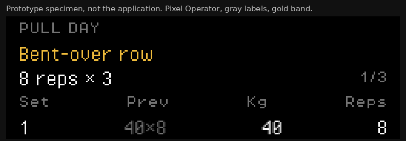

The band is the whole point. Cover the gold with a finger and the row is still a solid bar. Cover a gold `OK` on the current screen and the logged row disappears into the others.

## 8. Prioritized recommendations

### Priority 1 — Readability and hierarchy

**1. Adopt Pixel Operator at 16px and 8px, and stop forcing capitals.**

- Scope: replace the installed face in `src/index.tsx` / `hudFont.ts`, delete the lowercase alias and its test, add the two font files under a license note, and remove the uppercase transforms in `global.css` and `App.css`. Sentence case is then just the strings the components already have (`Complete`, `Bent-over row`, `Increase weight next session`).
- Benefit: word shape, `åäö`, a real size difference, tabular digits, crisp at the validator's width. The long sentence drops from 223px to 178px.
- Depends on: a passing `assessPicture` at 256px. If the TTF antialiases, redraw the glyphs through the square builder.
- Acceptance: the comparison strings in section 3 render with descenders; `Bänkpress` shows `ä`; `I` and `1` are not the same glyph; shell routes still pass the picture test.

**2. Split the five text roles, using the table in section 6.**

- Scope: `global.css` tokens (`--text-muted` becomes gray), `ExerciseBlock.tsx`, `PageHeader.tsx`, list pages. No new components are required if the classes exist (`section-title`, `muted`, `set-cell--muted`, `exercise-block__name`).
- Benefit: a name, a label, and a number stop being the same object. This is the change that makes the font swap visible. A new face set in all caps at 8px everywhere would waste the work.
- Depends on: item 1, and on gray sitting on black (item 4 can follow, but gray-on-blue will fail the region check).
- Acceptance: in a 256px screenshot of the session, the exercise name is taller than `SET`; `SET` is gray; the digits are white; a grayscale conversion still shows the current row.

**3. Rebuild the logging block and the catalog row as open bands.**

- Scope: `ExerciseBlock.tsx`, `summarizeTargets`, `ExerciseListPage.tsx`, the `.card` frame rules. Include the load in the target line. Rename the count header from the measurement. Mark the first unlogged set with the gold band.
- Benefit: the screen a lifter actually uses stops being a stack of identical windows, and the target line stops lying by omission.
- Depends on: items 1 and 2. The band is useless if the type inside it is still one size of capitals.
- Acceptance: the seeded session shows `40–50 kg` or the per-set weights in the summary; the catalog list has no `REPETITIONS/TOTAL` line; the current set is a full-width bar.

**4. Fix the template editor's crushed sentence and ellipsized name.**

- Scope: `TemplateForm.tsx` and `.row-split`. Stack the snapshot sentence. Move the four icon buttons into the expanded set.
- Benefit: the worst readable-text bug in the app, visible in `typography-menu/template-edit.png`, goes away even before the font swap, and is much better after it.
- Depends on: nothing, and it gets better with item 1.
- Acceptance: `Embedded exercises are snapshots…` is at least four words on the first line at 256px. `Bent-over row` is fully visible on the collapsed row.

### Priority 2 — A cohesive system

**5. Restrict blue panels and the white frame to one panel and to buttons.**

- Scope: `global.css` pane rule, home, lists, session header. Buttons keep a frame. List rows do not.
- Benefit: the hero stops competing with a field of boxes, and a 16×16 region gets a free color slot for gray.
- Depends on: item 3, or the session block loses its frame while the lists keep theirs and the app looks unfinished.
- Acceptance: a session screenshot has one blue region (the progress bar) or none. No list row has a white rectangle around it.

**6. Replace blue disabled text with silver on black.**

- Scope: `.btn:disabled`, `.set-cell--number:disabled`, `.form-input:disabled`.
- Benefit: disabled stops being invisible on a blue card. Silver is already a token (`$10`).
- Depends on: the control's background being black. If the row is the gold band, disabled does not apply to the current row.
- Acceptance: a disabled digit is readable on black and is not `#0000a8`.

**7. Label the tabs.**

- Scope: `App.tsx` and `.app-tabs`. The labels already exist on `primaryNavItems`.
- Benefit: the gold bar stops being the only name of a destination.
- Depends on: the 8px face from item 1, or the labels are the same unreadable capitals beside a 32px icon.
- Acceptance: each tab has a visible word, and the selected word is gold as well as the bar.

**8. Compact the date.**

- Scope: `src/utils/datetime.ts`. Keep a locale-aware order if it stays inside the glyph set.
- Benefit: the session header and the home card stop wrapping a timestamp with seconds.
- Depends on: the glyph set containing the separators used.
- Acceptance: a session header date fits on one line beside `BW 82.5 kg` at 256px.

**9. Prototype integer device-pixel scale, and compare it with the current fill-the-width scale.**

- Scope: `nesScale.ts`. Choose the largest integer `devicePixelRatio` multiple that fits, and paint the side bars black.
- Benefit: the font and the hero snap the same way. This is the actual fix for the 390px fringe, and no typeface provides it.
- Depends on: a decision to letterbox. The last pass chose not to. Ship it only if a side-by-side on a 390 CSS-pixel, device-pixel-ratio 3 capture shows the softness hurting the new face. A 16px face hides fractional scale better than an 8px face, because the features are bigger.
- Acceptance: a capture at device scale 3 has no off-palette pixels on a glyph edge, or the PR records that the softness was accepted and shows the photo.

### Priority 3 — Experiments

**10. Redraw the chosen face as 8×16 tiles for the JSON screen tool.**

- Scope: `nes/assets/fitnes.json` and a dashboard revision. Only if a JSON screen must share the UI face. Unifont slices cleanly. Pixel Operator needs each glyph padded to 8×16.
- Benefit: the dashboard and the app stop using two alphabets.
- Depends on: Priority 1 having picked the face. The pattern cap still applies to a 256×240 screen, so the dashboard keeps short strings.
- Acceptance: `npm run nes:validate` passes, and the dashboard's gray-label / white-value / gold-band structure is unchanged.

**11. Try the full m5x7 file only if the 16px logging screen is too tall.**

- Scope: download `m5x7.ttf` from itch, dump the cmap, reject it if `åäö` or `×` is missing, then photograph it against Pixel Operator on the session screen.
- Benefit: more characters per line if the x-height of 5px turns out to be acceptable in the hand.
- Depends on: Priority 1 being photographed first, so the comparison is real.
- Acceptance: side-by-side crops, and a written decision. Do not switch on the itch screenshot alone.

**12. A one-tile divider taken from the gym art.**

- Scope: a repeating 8×8 tile, black and blue or black and gray, used between home's hero and the list. Not a background behind text.
- Benefit: the poster and the menu share a motif without a texture under the letters.
- Depends on: the list no longer being a stack of frames, or the divider is one more box.
- Acceptance: the divider uses colors already in that region, and the letters stay on a flat ground.

## 9. Acceptance criteria for the next styling pass

The pass is better when all of the following are true. Photograph them. A single full-page screenshot is not the test.

**Readability**

- [ ] `Workout overview` shows a capital and lowercase, with a descender on a word that has one (`weight`, `session`).
- [ ] `Bänkpress` and `Knäböj` render `ä` and `ö`.
- [ ] `Increase weight next session` fits on one line at 256 logical pixels, or wraps at a word, not at a single capital.
- [ ] `1`, `I`, and `l`, and `0` and `O`, are distinguishable at the size used for digits. Photograph `Il1 O0 68 89`.
- [ ] The exercise name is visibly taller than the column header `SET`.
- [ ] Previous-session figures are quieter than the digits being entered.
- [ ] The catalog sentence is sentence case and is not the same size as the exercise name.

**Hierarchy**

- [ ] The current set is identifiable in a grayscale export of the session screenshot.
- [ ] Primary `Complete` and secondary `Delete` are not the same kind of button.
- [ ] The exercise list row does not contain `repetitions/total` or `bilateral`.
- [ ] The target line on a block names the load when the sets have a load.
- [ ] The count column header matches the measurement (`Reps` or `Sec`).
- [ ] The template snapshot sentence shows several words on its first line at 256px.
- [ ] `Bent-over row` is not ellipsized on the collapsed planned-set row.
- [ ] Each bottom tab has a visible word.
- [ ] Disabled text is silver on black, and a disabled input on a card is still readable.

**Coherence**

- [ ] List rows are not white-framed blue rectangles.
- [ ] At most one blue panel appears on the session screen.
- [ ] The hero and the logo are unchanged, and no texture runs under body text.
- [ ] Gold, gray, white, red, and blue still come from the existing CSS tokens. No new hex values.

**Renderer**

- [ ] `npm run check` passes, including `nes/pagePicture.test.ts`.
- [ ] A 256 CSS-pixel capture of `/`, `/exercises`, `/templates`, `/sessions`, and a seeded session has no `off-palette` and no `tile-colors` or `attribute-colors` problems from `assessPicture`.
- [ ] A 390 CSS-pixel capture is either snapped to integer device pixels or attached to the PR with the softness acknowledged.
- [ ] The start screen's native checkbox is either restyled with tiles or listed as a known exception. Today it is 691 off-palette pixels and the page test does not open it.
- [ ] No commercial game font is traced. The shipped file's license is in the repo next to the file.
- [ ] `hudFont.test.ts` no longer requires `a` and `A` to share a glyph, unless the project deliberately kept the HUD face.

## 10. References, licenses, and sources

### FitNES

- `src/app/hudFont.ts`, `src/app/hudFont.test.ts` — the installed face and the lowercase alias.
- `src/styles/global.css`, `src/App.css` — tokens, the uppercase transform, the window chrome, the set table.
- `src/app/nesScale.ts` — the column fills the viewport.
- `src/components/session/ExerciseBlock.tsx`, `src/components/session/resultEditing.ts` — the logging table and `formatSetReference`.
- `src/components/template/TemplateForm.tsx`, `src/pages/ExerciseListPage.tsx`, `src/pages/HomePage.tsx`.
- `nes/README.md`, `nes/pictureCheck.ts`, `nes/hardware.ts`, `nes/assets.ts`, `nes/layout.ts`, `nes/palette.json`.
- `nes/assets/fitnes.json` — the 8×8 HUD glyphs.
- `nes/examples/workout-dashboard.json` and `workout-dashboard@3.png` — gray labels, one panel, gold current band.
- `public/nes-style-reference.png` — mixed-case mood board. Not palette-legal, not a spec.
- Screenshots in `docs/design/typography-menu/`. Captured from this branch with seeded local data. Not fixtures.

### Case and reading

- Arditi, A. and Cho, J. "Letter case and text legibility in normal and low vision." *Vision Research* 47, no. 19 (2007): 2499–2505. <https://pmc.ncbi.nlm.nih.gov/articles/PMC2016788/>
- Nielsen Norman Group. "Typography for Glanceable Reading: Bigger Is Better." <https://www.nngroup.com/articles/glanceable-fonts/>
- Nielsen Norman Group. "UI Copy: UX Guidelines for Command Names." Short, specific, verb-led labels. <https://www.nngroup.com/articles/ui-copy/>

### Fonts inspected

| Face | Source | License as verified | Use |
| --- | --- | --- | --- |
| Pixel Operator, Pixel Operator 8 | <https://notabug.org/HarvettFox96/ttf-pixeloperator>. Files rendered from <https://github.com/ericoporto/pixel-utf8-fonts>. Name table: CC0 1.0, Jayvee Enaguas, 2009–2018 | CC0 1.0. Embed and modify freely | Prototype this |
| GNU Unifont | <https://unifoundry.com/unifont/>. File rendered: 14.0.04 from the mirror above | OFL 1.1, or GPL-2.0-or-later with the font embedding exception. Take OFL | Fallback |
| m5x7 | <https://managore.itch.io/m5x7> | Listing says CC0. The webfont actually inspected is ASCII-only | Experiment only after the pack's cmap is checked |
| m6x11 | <https://managore.itch.io/m6x11> | "Free to use with attribution." Not rendered | Optional later |
| Press Start 2P | <https://fonts.google.com/specimen/Press+Start+2P> | SIL OFL 1.1, reserved name "Press Start 2P" | Reject for body text |
| Silkscreen | <https://fonts.google.com/specimen/Silkscreen>, <https://kottke.org/plus/type/silkscreen/> | SIL OFL 1.1. Original cut has no lowercase | Reject; 5px ink |
| Cozette | <https://github.com/slavfox/Cozette> | MIT | Not the first prototype |
| VT323 | <https://fonts.google.com/specimen/VT323> | SIL OFL 1.1 | Reject; antialiases |

### Menus

- Final Fantasy menu structure. <https://finalfantasy.fandom.com/wiki/Menu_(Final_Fantasy)>
- Final Fantasy III (Famicom) manual, menu commands. <https://shrines.rpgclassics.com/nes/ff3/manual.shtml>
- Dragon Warrior IV. <https://strategywiki.org/wiki/Dragon_Warrior_IV>
- Crystalis items. <https://strategywiki.org/wiki/Crystalis/Items>
- Fire Emblem menu logic, via the SNES remake's command list. <https://www.fireemblemwod.com/fe3/ENG_menufe3.htm>
- Nova the Squirrel, variable-width inventory font. <https://forums.nesdev.org/viewtopic.php?t=12934> and <https://github.com/NovaSquirrel/NovaTheSquirrel>
- VOID LANCER. <https://github.com/Riyoway/void-lancer-nes>
- From Below. <https://mhughson.itch.io/from-below>

## Principles for the next styling pass

1. **Size and case carry the hierarchy.** Gold is a highlight, not a substitute for a taller word.
2. **Lowercase has to be at least as tall as today's capitals.** An 8px cell that shrinks the letters is not a readability win.
3. **One window per screen, one band per current row.** Frames are for buttons and for a single panel. Rows are rows.
4. **Gray labels live on the black ground.** A blue card that already has black, white, and gold has no color left.
5. **The picture check is the constraint. All-caps is not.** Stay inside the palette, the 8×8 tile, and the 16×16 region. Do not stay inside an uppercase glyph set the app invented.

## Anti-patterns

1. **A new face, still forced through `text-transform: uppercase` and an 8px line everywhere.** The font swap would be invisible.
2. **Gray text inside the current blue card.** It fails `attribute-colors` as soon as the region also contains black, white, and gold.
3. **Letter-spacing, CSS blur, a system sans, or a traced NES font, to make the screen "softer" or "more authentic."** The first three break the picture check or the readability goal. The fourth is forbidden by `nes/README.md`.

## Do these three first

1. Install Pixel Operator. Use the 16px cut for names, descriptions, and logging digits. Use Pixel Operator 8, uppercase, for kickers and column headers. Delete the lowercase alias and the body uppercase transform.
2. Make the current set a full-width gold band with black text, and make previous-session figures gray on the black ground.
3. Take the white frame off list rows. Let the catalog row be a name. Let the template sentence be full width.

## Validation checklist

**Readability.** Descenders are visible. `ä` and `ö` render. The name is taller than `SET`. The long sentence wraps on words. `1` and `I` differ at digit size.

**Coherence.** One blue panel on the session screen. No framed list rows. The hero is untouched. Gold means "current" or "primary," gray means "label" or "last time," white means "value."

**Compliance.** `npm run check` passes. A 256px capture of the shell and of a seeded session passes `assessPicture`. Disabled text is silver on black. The shipped font's license file is next to the font. No commercial letterforms are traced.
