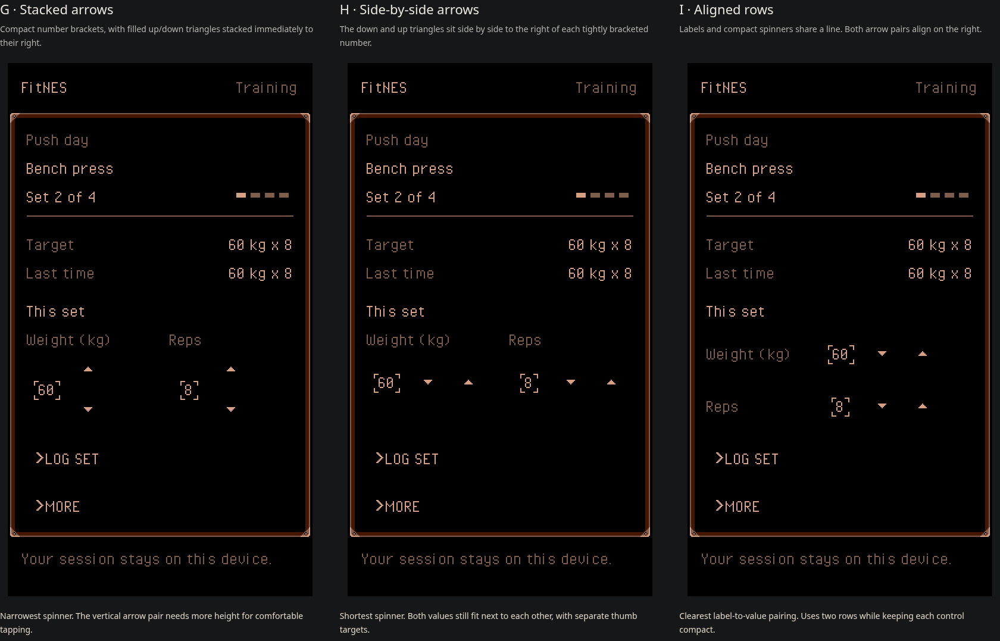

# Touch menu alternatives

Round 3 keeps the selected thick action chevron, reduces its gap to the label
from ten to two logical pixels, and tightens input brackets around the digits.
Filled up/down triangles to the right of each value now support small changes
without focusing an input or opening the virtual keyboard. Other text stays
mixed case. There are no raised plates, trailing action chevrons or underlines.



| Alternative | Spinner layout | Tradeoff |
| --- | --- | --- |
| G: Stacked arrows | Up above down, to the right of each number | Narrowest control; taller tap areas |
| H: Side-by-side arrows | Down then up, both to the right of each number | Shortest control; both fields fit beside each other |
| I: Aligned rows | Label, number and side-by-side arrows share each row | Clear label/value pairing; two rows |

The two-digit value's visible bracket box is now 22×16 logical pixels, down
from 104×40. Its invisible input target remains at least 34 pixels wide. Arrow
targets are separate 34×34 or 34×40 rectangles, with no overlapping hit areas.
Brackets and target widths grow with longer values, without recreating the
focused input. Every action retains its own bold 6×9 chevron.

Weight changes by 2.5 kg and reps by 1. These are demo step sizes; exercise-
specific increments remain undecided. Values clamp at zero and the editor's
upper limit; the corresponding arrow disables at a limit. Integer hundredths
preserve fractional weights across taps. Tap the number for keyboard entry, or
use the keyboard's up/down arrows while editing. Pressed controls invert and
focused inputs retain the compact corner-only treatment. H is the suggested
next candidate; the final spinner layout remains open.

The [first comparison](comparison.png) and [second comparison](comparison-round-2.png)
are retained as the earlier review rounds.

## Try the mockups

Run `npm run dev`, then open `/docs/design/touch-menus/`. Query parameters
`?option=g`, `?option=h`, and `?option=i` show one alternative at a time.

Adjust weight or reps with the triangles or tap a number for keyboard entry.
Log a set, open More, view the previous session, or skip a set. Changes remain in independent
in-memory demo state; the page imports no application boot code and never
opens IndexedDB. Reload resets the data. This is not a complete workout flow.

Build an isolated static preview without the app or its service worker:

```sh
npm exec vite build docs/design/touch-menus -- --outDir /workspace/fitnes/work/touch-menus/preview
```

The visible screen is rasterized at 256×448, then enlarged by a whole number of
device pixels per logical pixel. Transparent semantic buttons and inputs sit
over their drawn counterparts. They remain keyboard-accessible; focus is drawn
on the canvas. This is prototype scaffolding, not a proposed production renderer.

The four inks are the home's material palette, PPU `$0F`, `$07`, `$00`, `$10`
under Composite Direct with red emphasis. Each complete screen uses just that
one background palette and zero sprites. The verifier accepts at most 240 rows,
so check the upper and lower 224-row slices separately. The claim covers these
mockup screens, not a future composition with gym artwork and bottom tabs.

For a native PNG exported directly from a mockup's canvas:

```sh
node tools/prove-touch-menus.ts work/touch-menus/round-3/g-native.png work/touch-menus/round-3/g-proof
npm exec tsc -- --project docs/design/touch-menus/tsconfig.json
```

Round 3 passed `npm run check` (183 tests), the independent prototype typecheck
and static build. Browser checks covered one- and two-tap adjustments without
input focus, fractional weights, bounds and disabled arrows, widest-value
target separation, direct typing, keyboard arrows, independent state, logging
and nested menus. Phone checks at 390 CSS pixels / DPR 3 confirmed controls at
least 44×44 CSS pixels with no overlapping targets or horizontal overflow.
Twenty-four captured states passed exact hardware verification (48 slices),
and six initial screen slices reproduced in FCEUmm with zero differing pixels.
Screenshots above are actual browser captures. Generated native captures, ROMs
and reports stay under ignored `work/touch-menus/`.

## Sources and limits

- [Product direction](../../vision.md), [steel frame](../../../src/components/SteelPanel/README.md),
  and [home palette](../../../art/home/construction.json).
- Typography diagnosis from research commit `385e4a92773e26e82564fd527c8ab4038baa4e1f`.
- Licensed grid font retained byte for byte from `feat/focused-nes-ui` at
  `f3df2a3eb2a7bb9337c92e418d6bd34a08511f04`; provenance and CC0 license are in `fonts/`.
- The [selected DW3 menu capture](https://capture-487s.dw3-capture-preview.pages.dev/)
  could not be opened: the web tool could not access it and the environment's
  outbound policy rejected its host. Its source is not in the fetched branches.
  These candidates follow the vision's recorded short-menu direction; a direct
  visual comparison with that capture remains unverified. The available
  corridor frames were inspected, but do not substitute for the menu capture.

The repository refers to a `deploy-static-preview` skill that is not available
in this environment. The static build and screenshots can be reviewed locally;
an external branch preview is not deployed by this study.
