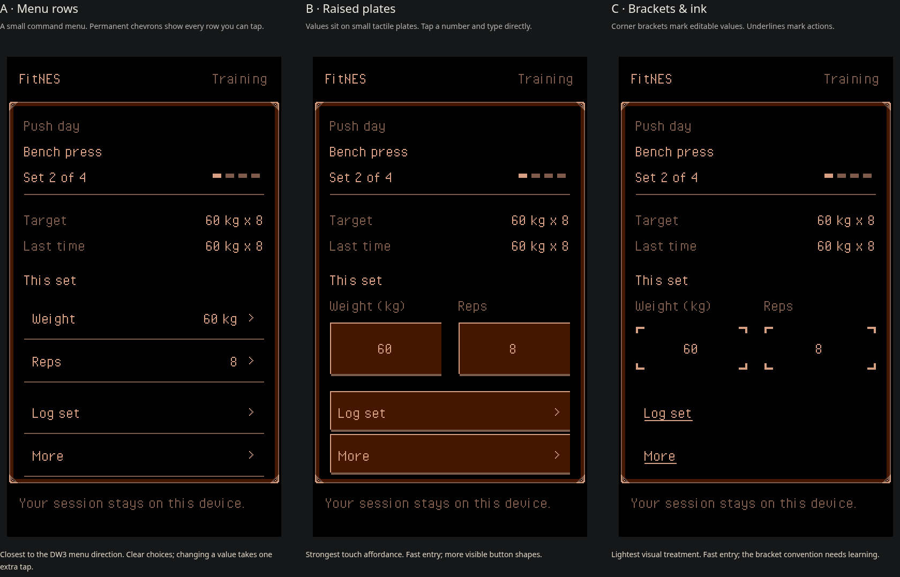

# Touch menu alternatives

Three interaction candidates, not an adopted product design. Every candidate
uses genuine mixed-case Pixel Operator, the approved steel frame, the same
workout content, and no selection cursor or hover dependency.



| Alternative | Persistent tap cue | Editing | Tradeoff |
| --- | --- | --- | --- |
| A: Menu rows | A chevron and rule on every command row | Tap a row, then type in the next menu | Closest to the documented DW3 menu hierarchy; one more tap |
| B: Raised plates | A light top edge and hard bottom shadow | Tap the value and type directly | Strongest touch cue; most visible chrome |
| C: Brackets and ink | Corner brackets around inputs; underlined action labels | Tap the value and type directly | Least chrome; bracket convention is less familiar |

Start with A's short navigation menus and B's directly editable values as a
candidate combination. C tests how much of the framing can be removed while
keeping actions discoverable. Font and case stay identical across the three so
they do not confound this comparison. No option has been selected by the owner.

## Try the mockups

Run `npm run dev`, then open `/docs/design/touch-menus/`. Query parameters
`?option=a`, `?option=b`, and `?option=c` show one alternative at a time.

Change weight or reps, log a set, open More, view the previous session, or skip a
set. Inputs use the phone's numeric keyboard. Changes remain in independent
in-memory demo state; the page imports no application boot code and never
opens IndexedDB. Reload resets the data. This is not a complete workout flow.

Build an isolated static preview without the app or its service worker:

```sh
npm exec vite build docs/design/touch-menus -- --outDir /workspace/fitnes/work/touch-menus/preview
```

The visible screen is rasterized at 256×448, then enlarged by a whole number of
device pixels per logical pixel. Transparent semantic buttons and inputs sit
over their drawn counterparts. They remain keyboard-accessible; focus is drawn
on the canvas. This is prototype scaffolding, not a proposed production renderer.

The four inks are the home's material palette, PPU `$0F`, `$07`, `$00`, `$10`
under Composite Direct with red emphasis. Each complete screen uses just that
one background palette and zero sprites. The verifier accepts at most 240 rows,
so check the upper and lower 224-row slices separately. The claim covers these
mockup screens, not a future composition with gym artwork and bottom tabs.

For a native PNG exported directly from a mockup's canvas:

```sh
node tools/prove-touch-menus.ts work/touch-menus/a-native.png work/touch-menus/a-proof
npm exec tsc -- --project docs/design/touch-menus/tsconfig.json
```

Verification for this review: `npm run check` passed (183 tests), the independent
prototype typecheck and static build passed, and Chromium interaction checks
passed at desktop size and 390 CSS pixels / DPR 3. Every phone control was at
least 44×44 CSS pixels. Eleven captured initial, editing, focus, pressed, and
submenu states passed the exact hardware verifier (22 slices). The six initial
screen slices reproduced in FCEUmm with zero differing pixels. Screenshots above
are actual browser captures. Generated native captures, ROMs and reports stay
under ignored `work/touch-menus/`.

## Sources and limits

- [Product direction](../../vision.md), [steel frame](../../../src/components/SteelPanel/README.md),
  and [home palette](../../../art/home/construction.json).
- Typography diagnosis from research commit `385e4a92773e26e82564fd527c8ab4038baa4e1f`.
- Licensed grid font retained byte for byte from `feat/focused-nes-ui` at
  `f3df2a3eb2a7bb9337c92e418d6bd34a08511f04`; provenance and CC0 license are in `fonts/`.
- The [selected DW3 menu capture](https://capture-487s.dw3-capture-preview.pages.dev/)
  could not be opened: the web tool could not access it and the environment's
  outbound policy rejected its host. Its source is not in the fetched branches.
  These candidates follow the vision's recorded short-menu direction; a direct
  visual comparison with that capture remains unverified. The available
  corridor frames were inspected, but do not substitute for the menu capture.

The repository refers to a `deploy-static-preview` skill that is not available
in this environment. The static build and screenshots can be reviewed locally;
an external branch preview is not deployed by this study.
