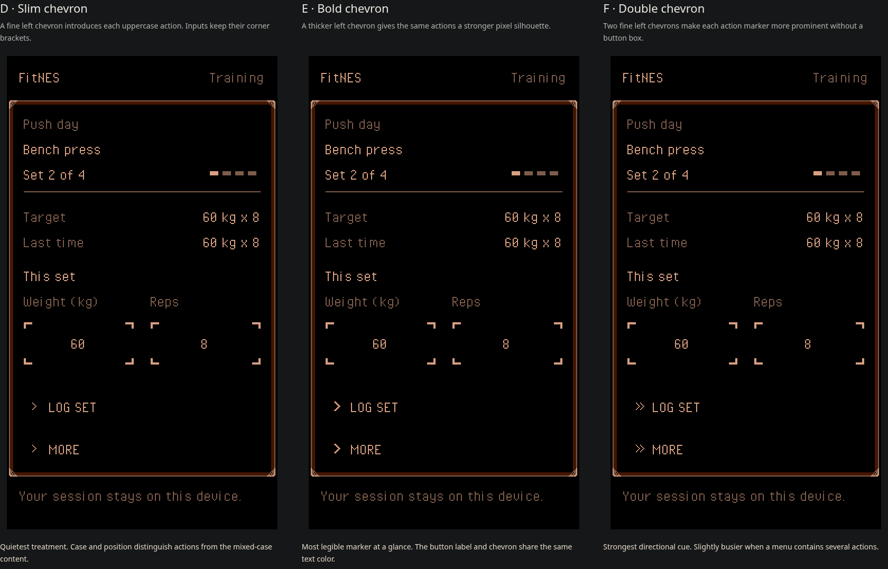

# Touch menu alternatives

Round 2 follows the owner's feedback: bracketed inputs remain a candidate;
raised plates are rejected. Actions now use uppercase labels with permanent
chevrons on their left. Other text stays mixed case. There are no right-side
chevrons or underlined actions. All three variants use the approved steel frame
and the same workout content, with no hover dependency.



| Alternative | Leading marker | Tradeoff |
| --- | --- | --- |
| D: Slim chevron | One 4×7 chevron | Quietest marker |
| E: Bold chevron | One 6×9 chevron with a two-pixel stroke | More legible at a glance |
| F: Double chevron | Two fine chevrons in an 8×7 pattern | More directional emphasis; busier in menus |

Font, case, input brackets, positions, spacing, and behavior stay identical so
the chevron itself is the comparison. Every action has its own marker. Pressed
or keyboard-focused actions invert temporarily; focused inputs retain their
corner-only shape with slightly thicker brackets. E is the suggested next
candidate; the owner has not selected a final variant.

The [first comparison](comparison.png) is retained as a record of round 1.

## Try the mockups

Run `npm run dev`, then open `/docs/design/touch-menus/`. Query parameters
`?option=d`, `?option=e`, and `?option=f` show one alternative at a time.

Change weight or reps, log a set, open More, view the previous session, or skip a
set. Inputs use the phone's numeric keyboard. Changes remain in independent
in-memory demo state; the page imports no application boot code and never
opens IndexedDB. Reload resets the data. This is not a complete workout flow.

Build an isolated static preview without the app or its service worker:

```sh
npm exec vite build docs/design/touch-menus -- --outDir /workspace/fitnes/work/touch-menus/preview
```

The visible screen is rasterized at 256×448, then enlarged by a whole number of
device pixels per logical pixel. Transparent semantic buttons and inputs sit
over their drawn counterparts. They remain keyboard-accessible; focus is drawn
on the canvas. This is prototype scaffolding, not a proposed production renderer.

The four inks are the home's material palette, PPU `$0F`, `$07`, `$00`, `$10`
under Composite Direct with red emphasis. Each complete screen uses just that
one background palette and zero sprites. The verifier accepts at most 240 rows,
so check the upper and lower 224-row slices separately. The claim covers these
mockup screens, not a future composition with gym artwork and bottom tabs.

For a native PNG exported directly from a mockup's canvas:

```sh
node tools/prove-touch-menus.ts work/touch-menus/round-2/d-native.png work/touch-menus/round-2/d-proof
npm exec tsc -- --project docs/design/touch-menus/tsconfig.json
```

Round 2 verification passed `npm run check` (183 tests), the independent
prototype typecheck and static build. Chromium checks covered uppercase action
labels, left-only markers, absence of underlines, corner-only input focus,
numeric editing, independent state, nested menus, press feedback and keyboard
focus. Phone checks at 390 CSS pixels / DPR 3 confirmed whole-device-pixel
scaling, no horizontal overflow, and controls at least 44×44 CSS pixels.
Eighteen captured states passed exact hardware verification (36 slices), and
all six initial screen slices reproduced in FCEUmm with zero differing pixels.
Screenshots above are actual browser captures. Generated native captures, ROMs
and reports stay under ignored `work/touch-menus/`.

## Sources and limits

- [Product direction](../../vision.md), [steel frame](../../../src/components/SteelPanel/README.md),
  and [home palette](../../../art/home/construction.json).
- Typography diagnosis from research commit `385e4a92773e26e82564fd527c8ab4038baa4e1f`.
- Licensed grid font retained byte for byte from `feat/focused-nes-ui` at
  `f3df2a3eb2a7bb9337c92e418d6bd34a08511f04`; provenance and CC0 license are in `fonts/`.
- The [selected DW3 menu capture](https://capture-487s.dw3-capture-preview.pages.dev/)
  could not be opened: the web tool could not access it and the environment's
  outbound policy rejected its host. Its source is not in the fetched branches.
  These candidates follow the vision's recorded short-menu direction; a direct
  visual comparison with that capture remains unverified. The available
  corridor frames were inspected, but do not substitute for the menu capture.

The repository refers to a `deploy-static-preview` skill that is not available
in this environment. The static build and screenshots can be reviewed locally;
an external branch preview is not deployed by this study.
