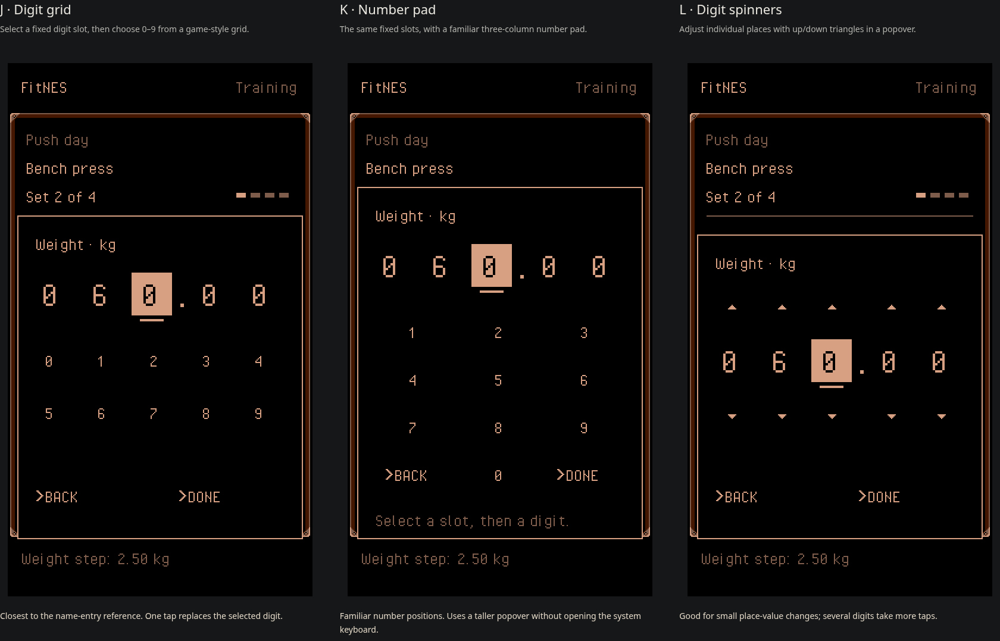

# Touch menu alternatives

Round 4 uses the supplied NES name-entry menu as the interaction reference:
fixed numerical slots and an on-screen picker in an overlapping game window.
All controls are semantic buttons; no text input or system keyboard is used.
The selected bold leading action chevron and mixed-case content remain.

The steel frame is used only for the top-level screen and cached as native
bitmap artwork. Each popover has a continuous one-logical-pixel outline.
Spinner arrows have no button borders; the 20-pixel-tall input corners align
with their upper and lower tips. All three picker alternatives remain available.

[Open the phone preview](https://fitnes-numeric-preview.eduardo-terroso.chatgpt.site/?option=j)
with the same ChatGPT account that owns this Site. This is a separate, private
preview with sample workouts, not the workout app's existing origin.



| Alternative | Popover | Tradeoff |
| --- | --- | --- |
| J: Digit grid | Select a digit slot, then tap 0–9 in two rows | Closest to the supplied game menu |
| K: Number pad | The same fixed slots, with a three-column keypad | Familiar key positions; taller window |
| L: Digit spinners | Up/down triangles for individual digit places | Convenient place-value changes; more taps for several digits |

Actual reps start at the planned value. The fixed masks are `08` for reps and
`060.00` kg for weight; the monospaced grid font and fixed control widths do not
move when values change. Pickers initially select the ones digit, making nearby
values quick to enter. Choosing a digit replaces that slot and advances the
caret. The decimal point is fixed, rather than another selectable slot.

Each value also has a compact, conventional stacked up/down pair on its right.
The small visible arrows are sixteen logical pixels apart, with separate larger
tap areas. These adjust the whole quantity by one rep or that exercise's weight
increment. `More` → `Edit increment` opens the same picker for the increment.
`More` → `Change exercise` switches between the barbell, dumbbell and cable
examples; each has an independent increment, initially 2.50, 1.00 and 5.00 kg.

Pointer interactions activate on primary press, before release; the generated
click does not apply the action a second time. Keyboard and assistive click
activation remain supported. There is no artificial interaction timer or
animation delay. Repaints reuse the cached native frame rather than drawing SVG
slices repeatedly during each interaction.

Edits take effect immediately. `Done`, Escape, or tapping outside the window
closes it; `Done` does not save a draft. `Back` clears the preceding slot and
moves the caret there. Weight/reps clamp at 999.99 kg / 99 reps. A weight
increment must be at least 0.01 kg. Integer hundredths avoid floating-point
errors. After logging a set, reps prefill from the plan again.

Only the demo's per-exercise increments persist, under the separate key
`fitnes-input-study-increments-v1` in localStorage. No application boot code,
IndexedDB access or real workout data is included. Blocking localStorage leaves
the preview functional in memory. The comparison alternatives have independent
in-memory values; settings are read from localStorage on reload.

The dialog has named buttons, a live value announcement, a focus loop and focus
restoration. Physical digit keys, left/right selection, up/down digit changes,
Backspace and Escape work. This preserves basic keyboard and assistive-technology
access without requiring the virtual keyboard.

## Run and build

Run `npm run dev` and open `/docs/design/touch-menus/`. Query parameters
`?option=j`, `?option=k`, and `?option=l` show one alternative; `?option=all`
compares all three. Phones default to J and put the working screen near the top.

```sh
npm exec tsc -- --project docs/design/touch-menus/tsconfig.json
npm exec vite build docs/design/touch-menus -- --outDir /workspace/fitnes/work/touch-menus/round-4/preview --emptyOutDir
```

The workout screen is rasterized at 256×448 and enlarged by a whole number of
device pixels per logical pixel. Transparent semantic buttons overlay the
rendering. This remains prototype scaffolding, not a production renderer.

All screen inks use the approved frame palette: PPU `$0F`, `$07`, `$00`, `$10`,
Composite Direct with red emphasis. The screen uses one background palette and
no sprites. The verifier checks its upper/lower 224-row crops without resizing:

```sh
node tools/prove-touch-menus.ts work/touch-menus/round-4/j-popover-native.png work/touch-menus/round-4/j-proof
```

Validation: `npm run check` passed (183 tests), as did the prototype typecheck
and static build. Chromium checks covered all three pickers, fixed masks,
immediate edits, no text inputs, planned rep reset, exercise-specific increments,
reload persistence, bounds, dialog focus/restoration, and phone taps. At 390 CSS
pixels / DPR 3, popover targets were at least 44×44 CSS pixels with no overlaps
or horizontal overflow. Fifteen captured states passed exact hardware checking
(30 slices); six popover slices reproduced in FCEUmm with zero differing pixels.
Additional checks verified changes before release, no duplicate release action,
keyboard activation, secondary-click rejection, continuous thin popover edges,
borderless spinner buttons, input/arrow alignment and cached bitmap-only repaints.
Generated native captures, ROMs and reports stay under ignored `work/`.

## Hosting and sources

The dedicated Sites project is `appgprj_6aeb936db9a08191ac56e4ab6b58683b`.
Its checkout is `/workspace/sites/fitnes-numeric-preview`, with identity and
static configuration in `.openai/hosting.json`. Keep this identity on subsequent
updates. The configured `dist/` contains the exact isolated static build above;
the canonical TypeScript remains in this repository. Preserve owner-only access.

- [Product direction](../../vision.md), [steel frame](../../../src/components/SteelPanel/README.md),
  and [home palette](../../../art/home/construction.json).
- The supplied name-entry screenshot informs fixed slots, a selected-digit
  indicator, an overlapping picker and Back/Done commands. Its commercial font
  and game artwork are not copied.
- Licensed grid font retained from `feat/focused-nes-ui` at
  `f3df2a3eb2a7bb9337c92e418d6bd34a08511f04`; provenance and CC0 license are in `fonts/`.
- Earlier comparisons: [round 1](comparison.png), [round 2](comparison-round-2.png),
  and [round 3](comparison-round-3.png).
