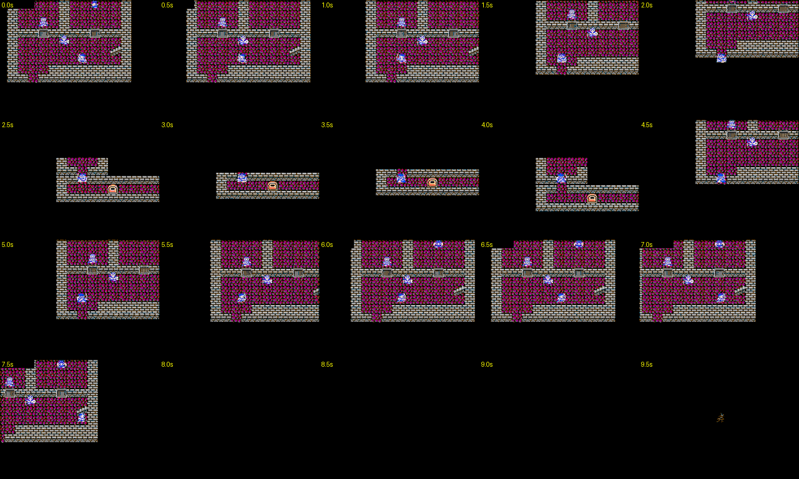

# Corridor timing reference

This is the original-pixel first contact sheet from the 30-second Dragon
Warrior III video segment at 592–622 seconds. It shows 20 samples at 0.5-second
intervals from 592.0 through 601.5 seconds. The selected sheet covers corridor
walking and the entrance to the black transition; it excludes the rest of the
long capture, extracted frame sequences, and video/audio streams.

The capture manifest describes corridor walking from 592.00 to 599.77s, a two
step fade to black from 599.77 to 599.87s, and a black hold from 599.87 to
601.60s. Its measured exit fade begins at 601.60s and lasts about 0.10s. These
are observations of the source video, not adopted FitNES animation timings or
interaction requirements.

Source video: [Let's Play Dragon Warrior III NES, Part 1](https://youtu.be/pLvXBDb-XPQ?t=592),
segment 592–622s. The source capture was retained in PR #13 at
`docs/captures/corridor-transition/contact_1.png` and
`docs/captures/corridor-transition/manifest.json`, commit
[`20bc3275240d723586f24877838c908bce5ffad3`](https://github.com/eduter/fitnes/tree/20bc3275240d723586f24877838c908bce5ffad3/docs/captures/corridor-transition).
The contact sheet is retained in the
[corridor art package](../design/corridor-interstitial/README.md); no second
image copy is needed. The manifest records the 854×480 segment crop at (124, 16),
scaled to 256×192 and mapped to the 64-entry NES palette. The retained image keeps the original
1280×768 contact-sheet pixels unchanged.
