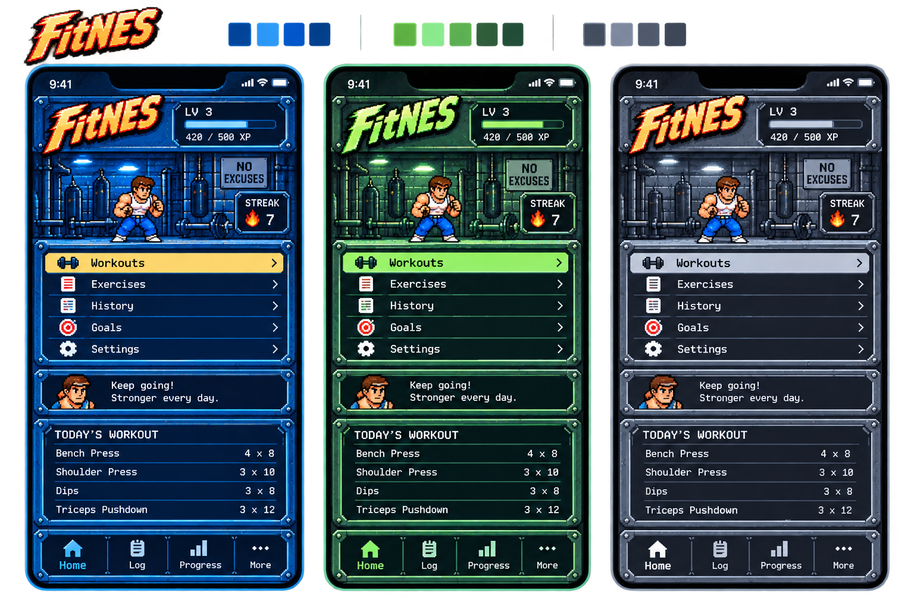

# Product vision

FitNES is a personal, offline-first PWA for logging workouts on a phone.
Keep workout data on-device and core flows usable without a connection.

## Workout experience

Recording work during training must be quick. Exercise names, planned work,
actual performance, actions, and session progress must be readable on a phone.

The existing model is a good starting point. Preserve its measurement and load
meanings when designing the interface; raise concrete gaps separately.

Use top-down character movement between sets to communicate workout progress.

## NES visual contract

The interface should feel like an NES game menu built for training. Follow
actual NES palette, tile, background attribute, and sprite constraints.
Use a 256-pixel logical content width; pages may extend vertically and scroll.
Preserve crisp pixel art when scaling for a device.

Owner decision (2026-11-04): pattern-bank/tile-count capacity is outside this
visual contract; colors and resolution remain constrained by actual NES hardware.
Legitimate hardware features such as MMC5 extended 8×8 attributes and PPUMASK
color emphasis may be used with an explicit construction and reproduction
proof. RGB must use a documented display interpretation of PPU codes, rather
than treating one emulator's RGB table as the only possible NES output.
Mid-frame palette rewrites need a verified timing/blanking plan before approval.
The [hardware proof verifier](../tools/nes-hardware/README.md) records supported
profiles and their limits.

**Only the owner may approve a visual exception for UX.** Demonstrate the
readability or interaction problem, explain the constraint, and propose
alternatives. Keep the constraint in force until the owner decides.
Record an approved exception's rationale, affected rule, and scope here.

Visual fidelity does not require an NES emulator, CPU timing, audio hardware,
or controller-only input. Research and prototypes are candidates until the
owner adopts them.

## Design direction

Owner direction (2026-11-04): use genuine mixed-case text. An all-caps interface
is tiring to read; do not use all caps throughout the product. Present several
alternatives together in each design-review round to speed convergence.

Owner refinement (2026-11-04): reject raised action/input plates. Explore corner
brackets for input fields, with uppercase action labels and a persistent chevron
on their left pointing toward the label. Keep other text mixed case. Do not use
right-side action chevrons or underlined actions; they suggest expansion and web
links respectively. Corner-bracket inputs remain a candidate pending review.

Owner refinement (2026-11-04): use the thick single action chevron, positioned
close to its label. Tighten input corner brackets around the value to conserve
logical pixels. Explore spinner inputs with filled triangles to their right so
small adjustments can be made in one or two taps without the virtual keyboard.

Owner refinement (2026-11-04): explore monospaced fixed numerical masks and
game-style popovers for number entry, following the supplied name-entry menu
reference. Keep compact, conventional stacked spinner arrows for small changes.
Initial actual reps should match the plan; weight increments should be
configurable per exercise and equipment. Review previews must have a hosted URL
that works on the owner's phone, rather than a workspace-local HTML link.

Owner refinement (2026-11-04): retain the digit grid, number pad and digit-spinner
alternatives. Use a thin continuous border for numerical popovers; reserve the
steel component for the top level. Remove spinner-button borders and align the
input corners vertically with the arrow tips. Numerical interactions should
respond immediately, without a deliberate delay.

Aim for the detail and finish of a well-made NES game. Use the **rightmost
charcoal/steel design** in the [style reference](style-reference.png)
as the art reference. Carry forward its dark panels, steel frames, shaped corners,
rivets, industrial gym scenery, and warm logo/character accents. Adapt texture
and shading to NES constraints while retaining depth, silhouettes, and contrast.

Reserve elaborate metal framing for top-level panels. The approved frame uses
4-pixel metal bars, riveted H-style corners with only the outermost corner pixel
cut off, and a 2-pixel black surround. The reusable [SteelPanel component](../src/components/SteelPanel/README.md)
implements this border; its uses and contents remain to be designed.

Use the [final home artwork's indexed palette and emphasis](../art/home/construction.json)
as the material-color reference for future icons and steel panels. Validate their
combined screen's shared palettes and budgets before adopting the composition.

Use the [standalone FitNES logo](fitnes-logo.png) as the logo source.

Use the [menu capture](https://capture-487s.dw3-capture-preview.pages.dev/)
for navigation: show a few choices, then expose further options through
subsequent menus, keeping workout interaction quick.

Use the [corridor capture](https://feat-corridor-transition.fitnes-corridor-capture-preview.pages.dev/)
for top-down character movement through the environment between sets. Develop
the graphics for FitNES; timing and interaction remain to be designed.

The [inventory](repo-status.md) locates useful existing code, artwork, and research.

## Preview in use

The owner uses [the compact preview](https://feat-compact-workout-ui.fitnes-preview.pages.dev/)
to evaluate the model. Its appearance is temporary.
Preserve its real workout data before clearing storage or replacing the
deployment; moving to another origin requires an explicit data transfer.
